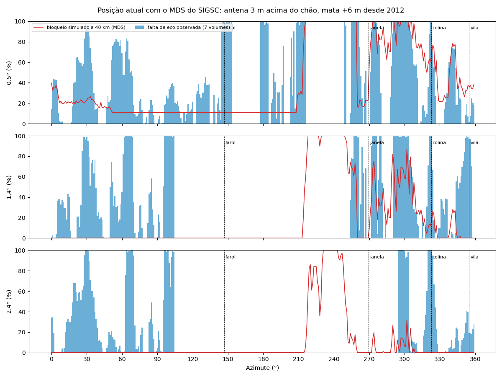
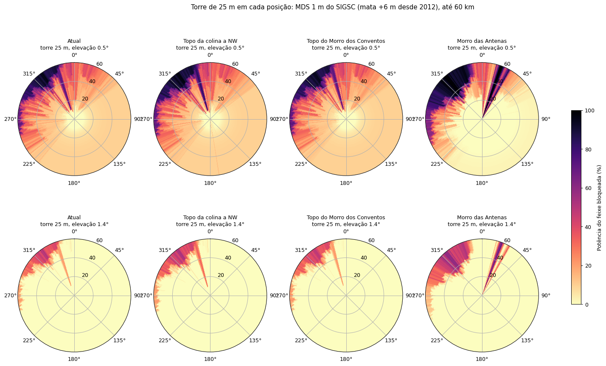
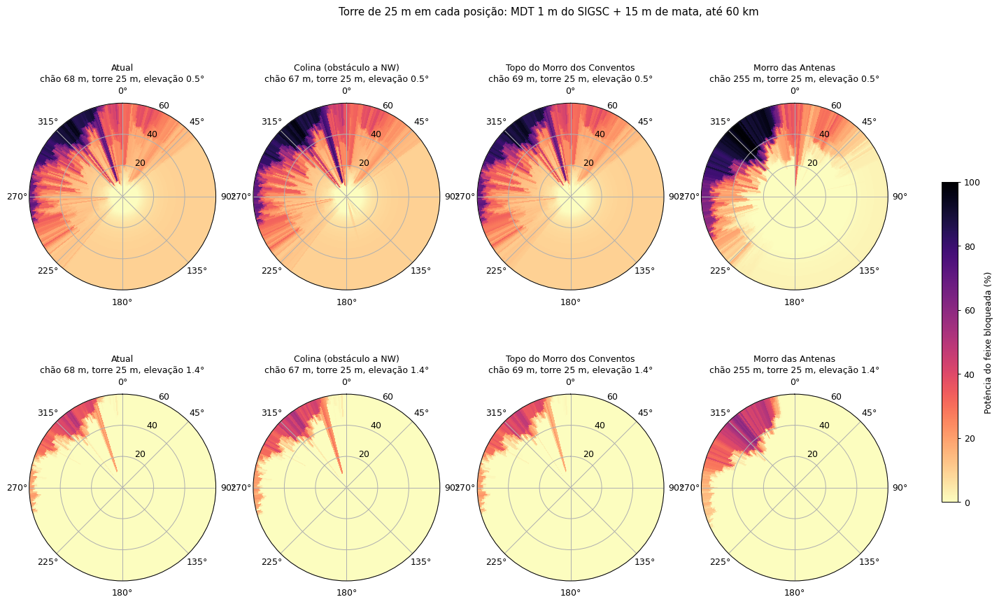

# Radar meteorológico de Araranguá: diagnóstico, bloqueios do feixe e posição alternativa

Versão 3, 20/11/2026. Relevo: **MDT e MDS de 1 m do SIGSC** (MDT das folhas SH-22-X-B-IV-3, SH-22-X-A-VI-4 e SH-22-X-B-IV-1; MDS das folhas B-IV-3 e B-IV-1, levantamento de 2010–2012) e SRTM fora delas.
Dados: 7 volumes do FTP da Defesa Civil de SC, de 16/11 23:58 a 19/11 23:36 UTC.

## Resumo

1. **A configuração do radar inutiliza o Doppler.** A PRF de 400/267 Hz em banda X dá velocidade de Nyquist de 6,4 m/s. A velocidade sai aleatória e o filtro de clutter, que depende dela, apaga raios inteiros de chuva. A recomendação é passar para **1200/900 Hz**: Nyquist estendido de ~29 m/s e 125 km de alcance sem ambiguidade, que cobre os 120 km processados (seção 2.1).
2. **Quem bloqueia o oeste é a mata do Morro dos Conventos, não o relevo.** No MDT, o topo do morro fica só 1,4 m acima do chão do radar, e só com o terreno o oeste fica livre a 1,4°. Com 15–20 m de mata sobre o terreno, a simulação reproduz o que os volumes mostram: no setor oeste (240–340°), a 30 km, 74–80% do feixe de 1,4° e 87–90% do de 0,5° ficam bloqueados. É a direção do interior e da Serra Geral. O MDS confirma que é mata: 10–17 m de árvores na crista a NW e no topo do morro (em 2012). Mas a mata de 2012 sozinha explica só parte da falta de eco a 1,4°; a de hoje é mais alta, ou há obstáculos a menos de 100 m da antena (seção 4.1).
3. **Araranguá aparece como eco de clutter, não como bloqueio.** Há eco forte e fixo a 268–271°, de 2 a 14 km (planície, estrada e cidade) e de 42 a 58 km (Serra Geral). Ele só aparece por uma "janela" de ~4°, provavelmente a abertura da estrada na mata. Prédios a 12 km não bloqueiam o feixe de forma relevante: mesmo um prédio de 80 m taparia no máximo ~32% do feixe de 0,5° e ~8% do de 1,4°, num azimute estreito. No MDS, os prédios mais altos no caminho do feixe têm 35–40 m (a 10–12 km) e tapam no máximo ~13% do feixe de 0,5° e nada do de 1,4°.
4. **Uma torre de 25 m resolve o oeste, inclusive no lugar atual.** No MDT, o chão do radar (67,8 m), o topo do Morro dos Conventos (69,2 m) e o topo da colina a NW (67,2 m) estão praticamente na mesma altura. O que bloqueia é a mata, então basta pôr a antena **25 m acima do chão** (pelo menos 5 m acima de mata de 20 m), em qualquer um desses pontos. A 30 km, no setor oeste, o bloqueio a 1,4° cai de 74% para 0–1%.

   | Antena 25 m acima do chão, mata de 15 m | Média, 30 km (0,5° / 1,4°) | Média, 60 km (0,5° / 1,4°) | Oeste, 30 km (0,5° / 1,4°) |
   |---|---|---|---|
   | Atual, -28,93455, -49,36249, antena como está hoje (~3 m) | 42% / 28% | 47% / 31% | 87% / 74% |
   | **Atual, -28,93455, -49,36249, com torre de 25 m** | **14% / 0%** | **32% / 7%** | **18% / 0%** |
   | Topo da colina a NW, -28,92524, -49,37070 | 15% / 0% | 33% / 8% | 19% / 0% |
   | Topo do Morro dos Conventos, -28,93725, -49,36762 | 14% / 0% | 32% / 8% | 17% / 0% |
   | Morro das Antenas, -28,84387, -49,39876 | 6% / 0% | 30% / 9% | 15% / 1% |

   Erguer a antena no lugar atual é a opção mais simples: dá o mesmo resultado que ir para a colina ou para o topo do Conventos, e a 25 m a antena também fica acima do farol. O Morro das Antenas (255 m, 10,7 km a 341° do radar atual) é um pouco melhor perto do radar e, pelo nome, provavelmente já tem acesso e energia (a confirmar). Lá, a torre do radar precisa ficar longe das torres de comunicação existentes, ou acima delas, porque elas também bloqueiam o feixe. O topo do Morro dos Conventos fica a 580 m do radar atual, no mesmo terreno.

5. **O radar quase não detecta ecos fracos.** Em 47 volumes, a menor refletividade detectada é de ~30 dBZ a 20 km, ~38 dBZ a 40 km e ~48 dBZ a 80 km, o que equivale a ~5–10 dBZ a 1 km. Um radar de banda X costuma detectar algo da ordem de −20 a −30 dBZ a 1 km. A chuva fraca e estratiforme (abaixo de 30 dBZ) fica invisível além de ~20 km. Mesmo em chuva de 35–45 dBZ, a relação sinal-ruído fica em 5–8 dB, e por isso o RhoHV sai baixo e o ZDR negativo. Isso precisa ser verificado com o fabricante: potência transmitida, compressão de pulso, nível de ruído e calibração (seção 2.2).
6. **KDP e ZDR ainda não servem para medir o bloqueio.** O método de autoconsistência Z–ΦDP foi aplicado, mas com sinal-ruído tão baixo o resultado é ruído de ±5–10 dB por setor. O ZDR em chuva tem mediana de −0,3 a −1,3 dB, quando deveria ser positivo: precisa de calibração (seção 4.2).

## 1. O radar

| Item | Valor (metadados ODIM) |
|---|---|
| Equipamento | EEC Ranger, software EDGE 6.2.3, banda X (λ = 3,19 cm) |
| Feixe | 2,18° (H) × 2,20° (V); ganho 36,2 dB; potência nominal 410 W |
| Varredura | 5 elevações (0,5°, 1,4°, 2,4°, 3,4°, 4,5°), 360 raios × 3840 bins de 31,25 m (120 km), a cada ~5 min |
| PRF | 400 / 267 Hz (dual-PRF 3:2), Nyquist 6,38 m/s |
| Posição real | -28,934548, -49,362490 |
| Posição nos arquivos | -28,9346, -49,3627 (21 m da real); altitude declarada 46 m |
| Chão no MDT do SIGSC | 67,8 m; o melhor ajuste aos volumes põe a antena ~3 m acima dele |

As altitudes medidas no Google Earth (antena a 49 m, colina a 57 m) ficam ~10–19 m abaixo do MDT nos mesmos pontos. O relatório usa o MDT do SIGSC, que é o levantamento oficial com precisão altimétrica de 1 m.

## 2. Problemas de configuração e processamento

**PRF baixa.** Com PRF de 400 Hz em banda X, mesmo uma chuva com largura espectral de 1,5–2 m/s dá SQI de 0,1–0,3. Nos ecos de chuva (RhoHV ≥ 0,95 e SNR ≥ 20 dB), a velocidade varia entre raios vizinhos tanto quanto um valor sorteado (mediana de 2,7–3,7 m/s, contra 3,7 m/s de um valor aleatório). O filtro de clutter Doppler remove 73% do eco bruto a 0,5° e 25% a 2,4–4,5°, onde quase não há clutter. A PRF de 400 Hz dá 375 km de alcance sem ambiguidade, mas o radar processa só 120 km.

**Zona cega de 2,2 km.** Até 2,17 km todos os raios, em todas as direções, ficam saturados em ~74 dBZ. É o receptor captando o pulso transmitido (14,3 µs de ida e volta). Não há medida real nesse disco.

**Clutter.** Os ecos de 30 dBZ ou mais têm RhoHV mediano de 0,54–0,71 a 0,5°, valor de mar e relevo, não de chuva.

### 2.1 Por que mudar a PRF, e para quanto

A PRF (frequência de repetição de pulsos) define três coisas ao mesmo tempo: a maior velocidade que o radar mede sem ambiguidade, o alcance máximo sem ambiguidade e quantos pulsos entram em cada raio. Em banda X (λ = 3,19 cm), as fórmulas são:

- velocidade de Nyquist: V = λ · PRF / 4;
- alcance sem ambiguidade: R = c / (2 · PRF);
- coerência entre pulsos (SQI) para uma chuva com largura espectral σ: SQI ≈ exp(−8 π² σ² / (λ · PRF)²).

| | Hoje: 400 / 267 Hz | Recomendado: 1200 / 900 Hz |
|---|---|---|
| Nyquist de cada PRF | 3,2 / 2,1 m/s | 9,6 / 7,2 m/s |
| Nyquist estendido (dual-PRF) | 6,4 m/s | ~29 m/s |
| Alcance sem ambiguidade | 375 / 562 km | 125 / 167 km |
| SQI com σ = 1,5 m/s | 0,34 | 0,94 |
| SQI com σ = 2 m/s | 0,14 | 0,81 |
| Pulsos por raio (mesma rotação) | 1× | 3× |

**O problema da PRF atual.** Com 400 Hz em banda X, a velocidade de Nyquist (3,2 m/s em cada PRF) é menor que a própria largura espectral de uma chuva comum, que fica entre 1 e 3 m/s. O espectro ocupa todo o intervalo de Nyquist e os pulsos sucessivos ficam praticamente descorrelacionados. Isso tem três efeitos:

1. **A velocidade sai aleatória.** O SQI fica em 0,1–0,3, como medido nos volumes, e a velocidade varia entre raios vizinhos tanto quanto um valor sorteado. Ventos de 10–40 m/s dobram várias vezes, e nem a extensão dual-PRF (6,4 m/s) consegue desdobrá-los.
2. **O filtro de clutter apaga chuva.** O filtro Doppler remove o que tem velocidade perto de zero. Com um intervalo de Nyquist tão estreito, o entalhe do filtro ocupa boa parte dele, e a chuva dobrada para perto de zero também é apagada. Isso explica os 73% de eco removidos a 0,5° e os 25% removidos a 2,4–4,5°, onde quase não há clutter.
3. **O alcance sobra.** Os 375 km sem ambiguidade são três vezes o que o radar processa (120 km). A PRF baixa não traz nenhuma vantagem aqui.

**Para quanto mudar.** O critério é usar a maior PRF cujo alcance sem ambiguidade ainda cubra os 120 km processados. Com 1200 Hz, ele é de 125 km. Para o modo dual-PRF, a razão 4:3 (1200/900 Hz) dá ~29 m/s de Nyquist estendido, o bastante para os ventos de tempestade da região; a 3:2 (1200/800 Hz) daria só ~19 m/s.

- Ecos de segunda volta, de alvos além de 125 km, ficam fracos em banda X por atenuação e altura do feixe. Mesmo assim, convém ligar a supressão de segunda volta por fase, se o equipamento tiver.
- Com o triplo de pulsos por raio, o ruído das estimativas também cai.

**A confirmar com o fabricante.** A potência de 410 W indica transmissor de estado sólido com compressão de pulso. Se for o caso, a zona cega de 2,2 km (14,3 µs) é a duração do pulso longo, e o ciclo de trabalho a 1200 Hz (~1,7%) deve estar dentro do limite. Esses equipamentos costumam ter um pulso curto de preenchimento para cobrir a zona cega, e vale verificar se ele está ligado.

### 2.2 Sensibilidade muito baixa

A menor refletividade que o radar detecta (Zmin = TH − SNR) foi medida em 47 volumes de 16 a 20/11, a 2,4°, onde há pouco clutter (`sensibilidade_alcance.csv`):

| Distância | Menor TH detectado (1% dos gates) | Zmin | Zmin reduzido a 1 km |
|---|---|---|---|
| 5 km | 27 dBZ | 24 dBZ | 10 dBZ |
| 10 km | 34 dBZ | 31 dBZ | 11 dBZ |
| 20 km | 32 dBZ | 30 dBZ | 4 dBZ |
| 40 km | 39 dBZ | 38 dBZ | 6 dBZ |
| 60 km | 45 dBZ | 44 dBZ | 8 dBZ |
| 100 km | 53 dBZ | 52 dBZ | 12 dBZ |

O Zmin cresce com o quadrado da distância, como esperado; o problema é o nível. Um radar meteorológico de banda X costuma detectar da ordem de −20 a −30 dBZ a 1 km. Aqui o limite é de ~5–10 dBZ, cerca de **25–35 dB a menos**. Os dados mostram isso independentemente do campo SNR: quase não há gates com TH abaixo de 30 dBZ além de 10 km.

**Consequências:**
- chuva fraca e estratiforme (< 30 dBZ) não aparece além de ~20 km, nem a de 40 dBZ além de ~40 km;
- mesmo em chuva de 35–45 dBZ, o SNR fica em 5–8 dB. Com esse SNR, o RhoHV cai (mediana de 0,88–0,93 em chuva, quando deveria passar de 0,97), o ZDR fica enviesado e o ΦDP fica ruidoso. Parte do "RhoHV de clutter" da seção 2 vem disso;
- a máscara de RhoHV ≥ 0,8 usada nas imagens apaga também chuva fraca de baixo SNR.

**Causas possíveis, a verificar com o fabricante:**
- potência transmitida abaixo dos 410 W nominais;
- compressão de pulso desligada ou com defeito, o que num transmissor de estado sólido custa 20–30 dB;
- perdas no guia de onda ou na junta rotativa;
- ruído do receptor alto;
- constante de calibração errada.

Uma comparação com o radar de Chapecó, ou com o radar do GPM, em chuva comum, separa a calibração de Z da sensibilidade.

## 3. Bloqueios e ecos fixos observados

Fração de pontos com eco (TH ≥ 10 dBZ, 5–40 km), média dos 7 volumes:

| Setor | 0,5° | 1,4° | 2,4° | 3,4° | 4,5° | Causa provável |
|---|---|---|---|---|---|---|
| ~215–300° | sem eco ou forte falta | 60–100% de falta em 255–310° | falta em 295–305° | — | — | mata do topo do Morro dos Conventos |
| 321–324° | 2–5% (vizinhos 40–90%) | 0–1% | 0–1% | 0–2% | 6–7% (vizinhos 8–9%) | mata alta na colina a 1,3 km, ou objeto perto da antena |
| 352–356° | 59–78% (vizinhos 95%) | 0–0,5% (vizinhos 9–21%) | normal | normal | normal | não explicado (vila e árvores ficam abaixo do feixe) |
| a partir de 146° | 0% (antes 8–18%) | — | — | — | — | farol (15 m, topo 8 m acima da antena); depois vem o mar sem eco |

**Ecos fixos a 268–271°** (≥ 35 dBZ em 6 dos 7 volumes):

| Distância | 0,5° | 1,4° | 2,4° | O que é |
|---|---|---|---|---|
| 2–14 km | 91–100% dos pontos | 70–100% | ~0% | planície, Rua Morro dos Conventos, rede elétrica e cidade de Araranguá (centro a 270°, 12 km) |
| 14–42 km | 0–20% | 0% | 0% | — |
| 42–58 km | 49–100% | 32–100% | 0% | escarpa da Serra Geral |

Nesses pontos o RhoHV mediano é de 0,81–0,87 e o SQI de 0,11: alvos fixos, não chuva. Não é interferência de transmissor, que apareceria em todo o alcance. Nos setores vizinhos quase não há eco fixo (0,0–0,7%). A explicação mais provável é uma abertura na mata do morro, na direção da estrada (a Rua Morro dos Conventos sai a ~264°), que deixa o feixe passar só ali.

## 4. Simulação do bloqueio

Método: bloqueio parcial do feixe (Bech et al., 2003), com Terra de raio efetivo 4/3, feixe de 2,2° e bloqueio acumulado ao longo do raio.

**Relevo:**
- MDT de 1 m do SIGSC nos primeiros 2 km de cada posição.
- O mesmo MDT reduzido a 5 m, guardando o máximo de cada bloco (o lado seguro), no resto das três folhas.
- SRTM de 30 m fora delas.

As folhas 1:10.000 do SIGSC não declaram nodata e têm nas bordas uma moldura de 0 e −9999 m que se sobrepõe ~270 m à folha vizinha. Na primeira montagem, essa moldura aparecia como uma faixa de 0 m cortando o morro a −49,376° (emenda entre SH-22-X-B-IV-3-SO-D e SE-C). O mosaico agora usa o maior valor nas sobreposições, o que elimina a faixa. Refeitas as contas, nenhum número do relatório mudou: a faixa era um vale falso e ficava fora dos caminhos que bloqueiam o feixe.

Mata e casas entram como altura somada ao terreno em terra firme. Os primeiros 100 m não entram: ali o feixe ainda está em campo próximo.

**Calibração com os volumes observados:**

| Antena acima do chão / mata | Oeste a 30 km, simulado (0,5° / 1,4° / 2,4°) | Correlação com a falta de eco (0,5° / 1,4° / 2,4°) |
|---|---|---|
| 3 m / sem mata | 20% / 0% / 0% | 0,11 / −0,09 / — |
| 3 m / 10 m | 81% / 59% / 41% | 0,29 / 0,19 / — |
| **3 m / 15 m** | **87% / 74% / 63%** | **0,33 / 0,28 / 0,35** |
| 3 m / 20 m | 90% / 80% / 73% | 0,35 / 0,24 / 0,17 |

Sem mata, o MDT não explica a falta de eco a oeste. Com 15–20 m de mata, explica. A correlação de ~0,3 é modesta, porque os 7 volumes têm chuva em lugares diferentes. O setor 321–324° só chega perto do observado (92% a 1,4°) com mata de 25 m na colina (60–75%).

**Curvatura da Terra, refração e difração.** A altura do feixe já inclui a curvatura da Terra e a refração padrão (raio efetivo k·R com k = 4/3). Como a costa tem com frequência super-refração (ar frio e úmido sobre o mar), a simulação foi repetida com k = 1 (sem refração), 2 e 4 (`sensibilidade_refracao.csv`, figura `v2_refracao.png`). Na posição atual, o bloqueio médio a 30 km varia de 41% a 44% a 0,5° e fica em 28% a 1,4°; o do setor oeste não muda (87% / 74%), e a correlação com o observado fica em 0,33–0,34. O motivo é que o bloqueio vem da mata a menos de 1 km, onde a curvatura do feixe é de centímetros. Nas posições novas, a super-refração forte (k = 4) aumenta o bloqueio médio a 60 km e 0,5° em 4–5 pontos (o feixe passa ~100 m mais baixo a 50 km). A difração não está no modelo: na banda X, a 1ª zona de Fresnel tem 4–6 m de raio a 0,6–1,1 km, contra 11–21 m de raio do feixe, então ela só suaviza a borda da sombra.

**Prédios.** O MDT não tem prédios, mas a geometria limita o efeito deles. O centro de Araranguá fica a 12 km, a 11 m de altitude, e a Terra curva ~8,5 m nessa distância. Um prédio de H metros tapa esta fração do feixe:

| Altura do prédio | Topo visto da antena | Feixe de 0,5° | Feixe de 1,4° |
|---|---|---|---|
| 30 m | −0,18° | ~23% | ~5% |
| 50 m | −0,09° | ~26% | ~6% |
| 80 m | +0,06° | ~32% | ~8% |

Cada prédio ocupa uma fração pequena de grau em azimute (20 m a 12 km dá 0,1°). O efeito médio é pequeno; o que os prédios causam é clutter (seção 3).

## 4.1 Com o MDS: mata e prédios reais

O MDS (modelo digital de superfície) inclui árvores e construções. MDS − MDT dá a altura de cada uma, com 1 m de resolução. Na simulação, a superfície passou a ser o próprio MDS, com filtro mediano 3×3 contra picos isolados (fios, aves, ruído). Fora das folhas do MDS, continua o MDT + 15 m de mata. Script: `analise_mds.py`.

**Altura da superfície nos pontos estudados (2010–2012):**

| Ponto | MDS − MDT no ponto | Maior valor num raio de 40 m |
|---|---|---|
| Radar atual | 3,8 m | 24,7 m |
| Topo da colina a NW | 8,5 m | 16,7 m |
| Topo do Morro dos Conventos | 5,7 m | 9,7 m |
| Vila (352–356°) | 0,2 m | 12,5 m |
| Morro das Antenas | 0,0 m | 13,2 m |
| Centro de Araranguá | 10,4 m | 21,1 m |

O levantamento é de 2010–2012, anterior ao radar: a torre atual não aparece, e a mata cresceu desde então. Por isso a calibração testou um crescimento de 0, 3 e 6 m onde havia vegetação ou construção (`mds_calibracao.csv`):

| Mata | Antena acima do chão | Começo da simulação | Oeste a 30 km (0,5° / 1,4° / 2,4°) | Correlação com o observado (0,5° / 1,4° / 2,4°) |
|---|---|---|---|---|
| MDS de 2012 | 3 m | 100 m | 37% / 8% / 1% | 0,26 / 0,19 / 0,12 |
| MDS + 3 m | 3 m | 100 m | 57% / 19% / 4% | 0,35 / 0,30 / 0,09 |
| **MDS + 6 m** | **3 m** | **100 m** | **72% / 39% / 13%** | **0,36 / 0,34 / 0,23** |
| MDS + 3 m | 3 m | 50 m | 90% / 71% / 46% | 0,32 / 0,19 / 0,19 |
| MDS + 6 m | 10 m | 100 m | 33% / 6% / 1% | 0,24 / 0,15 / — |

**O que o MDS mostra:**

- **A mata de 2012 não basta.** Ela bloqueia só 8% do feixe de 1,4° no oeste, contra 60–100% de falta de eco observada. O melhor ajuste usa a mata 6 m mais alta que em 2012, com a antena ~3 m acima do chão, e chega a 39%. Para chegar perto do observado (71%), é preciso incluir obstáculos entre 50 e 100 m da antena. A simulação normalmente começa a 100 m, porque mais perto o feixe ainda está em campo próximo. Isso indica que **árvores no entorno imediato do radar** também tapam o feixe, além da mata da crista.
- **"Janela" de 268–271°.** O MDS mostra mata mais baixa (9–14 m, a 270–350 m da antena) na direção da estrada, e a simulação abre uma fresta a 0,5° entre ~262° e 268°. A falta de eco observada abre em 268–271°, 2–4° adiante. Isso confirma que a janela é uma abertura na mata. A diferença de 2–4° pode ser um erro de alinhamento do radar com o norte, a verificar com uma varredura do Sol.
- **Setor 321–324°.** A 0,5°, o feixe é bloqueado a 640–750 m da antena, por mata de 10–17 m na crista que liga o radar à colina, e não pelo topo da colina (1,3 km). A 1,4°, a mata de 2012 não bloqueia (14%). O eco quase nulo observado (0–1%) pede algo mais alto hoje: árvores que cresceram ou um objeto perto da antena.
- **Setor 352–356°.** O MDS não explica o setor: a vila e as árvores em volta (até 12 m) ficam abaixo do feixe. A causa mais provável é um objeto a menos de 100 m da antena, fora do alcance da simulação, como um poste, um mastro, para-raios ou uma árvore no terreno do radar. Precisa de verificação no local.
- **Prédios de Araranguá.** Os mais altos no caminho do feixe (255–285°, 9–15 km) têm 35–40 m, como a 271° e 12,4 km (topo a 41 m de altitude) e a 284° e 10,2 km (44 m). Vistos da antena, ficam 0,7° abaixo do centro do feixe de 0,5°: tapam no máximo ~13% dele e nada do de 1,4°, em faixas de décimos de grau. Pesa mais um morro com mata a 10–11 km, a 266–268° (topo a ~82 m), que tapa ~20–30% do feixe de 0,5° (`mds_cidade.csv`). Os prédios explicam o clutter, não a falta de eco.

## 4.2 Bloqueio pelos dados polarimétricos (KDP e ZDR)

**Ideia.** A fase diferencial ΦDP (e o KDP, sua derivada) não depende da potência recebida. Quando parte do feixe é bloqueada, a refletividade cai, mas o ΔΦDP acumulado na chuva continua o mesmo. Na chuva, KDP ≈ c·Z^b. Comparando o ΔΦDP medido com o esperado pela refletividade, num azimute bloqueado e num livre, obtém-se a perda de potência em cada azimute: é o método de autoconsistência (Giangrande & Ryzhkov, 2005; Lang et al., 2009). O ZDR serve para outra coisa: em chuva fraca ele vale ~0,2–0,5 dB, então desvios por azimute indicam bloqueio diferencial entre H e V, e o desvio médio indica erro de calibração.

**Aplicação.** Script `analise_polarimetrica.py`, sobre 47 volumes de 16 a 20/11, com as seguintes escolhas:
- gates de chuva com RhoHV ≥ 0,95 e SNR ≥ 10 dB;
- atenuação corrigida com α = 0,28 dB/° e β = 0,04 dB/°;
- b = 0,8;
- referência nos azimutes de 30–200°, a 1,4° e 2,4°.

**Resultado: inconclusivo.** Só 2.173 raios tiveram chuva suficiente (ΔΦDP ≥ 4°), poucos por setor de 5°. A perda estimada oscila de −10 a +7 dB entre setores vizinhos, sem relação com os bloqueios conhecidos (`polarimetria_azimute.csv`, figura `v3_polarimetria.png`). O motivo é o SNR baixo da seção 2.2: o ΦDP tem textura mediana de 4° e cauda de 14°, e vem quantizado em passos de 1,4°. Não houve gates de chuva fraca (20–30 dBZ) com SNR ≥ 10 dB e RhoHV ≥ 0,95, então não foi possível medir o ZDR por azimute.

**ZDR descalibrado.** Na chuva de 35–45 dBZ, o ZDR mediano é de −0,3 a −0,4 dB, quando deveria ser de +0,5 a +1,5 dB. Na de 25–30 dBZ, é de −1,2 dB. Há um erro de calibração de pelo menos ~1 dB, somado ao viés do SNR baixo. A correção é uma **varredura vertical (birdbath)** em chuva fraca, onde o ZDR verdadeiro é zero.

**Quando volta a servir.** Com a sensibilidade corrigida e o ZDR calibrado, o mesmo script mede o bloqueio real de cada azimute a partir de um dia de chuva estratiforme espalhada. É a melhor validação das simulações deste relatório e da correção de bloqueio no produto de chuva.

## 5. Posições alternativas

Posições estudadas (WGS84; chão pelo MDT do SIGSC; distância e azimute a partir do radar atual):

| Posição | Latitude | Longitude | Chão no MDT | Distância / azimute |
|---|---|---|---|---|
| Atual (radar) | -28,934548 | -49,362490 | 67,8 m | — |
| Topo da colina a NW | -28,925236 | -49,370698 | 67,2 m | 1,31 km / 322° |
| Topo do Morro dos Conventos | -28,937250 | -49,367620 | 69,2 m | 0,58 km / 239° |
| Morro das Antenas | -28,843869 | -49,398756 | 255,1 m | 10,66 km / 341° |

Bloqueio médio, MDT + mata (sensibilidade completa em `sensibilidade_v2.csv` e `sensibilidade_colina.csv`):

| Posição | Antena acima do chão | Mata | Média, 30 km (0,5° / 1,4°) | Média, 60 km (0,5° / 1,4° / 2,4°) | Oeste, 30 km (0,5° / 1,4°) |
|---|---|---|---|---|---|
| Atual | 3 m | 15 m | 42% / 28% | 47% / 31% / 24% | 87% / 74% |
| Atual | 15 m | 20 m | 36% / 17% | 43% / 21% / — | 74% / 46% |
| **Atual** | **25 m** | 10–20 m | **14–15% / 0%** | **32% / 7–8% / —** | **17–19% / 0%** |
| Topo da colina a NW | 15 m | 20 m | 26% / 7% | 43% / 15% / — | 22% / 0% |
| Topo da colina a NW | 25 m | 10–20 m | 15–16% / 0% | 33–34% / 8% / — | 19–20% / 0% |
| Topo do Conventos | 15 m | 20 m | 44% / 24% | 61% / 32% / 16% | 19% / 0% |
| Topo do Conventos | **25 m** | 10–20 m | 14% / 0% | 32% / 8% / 0% | 17% / 0% |
| Morro das Antenas | 15 m | 20 m | 26% / 15% | 46% / 24% / 9% | 16% / 1% |
| **Morro das Antenas** | **25 m** | 10–20 m | **6–7% / 0%** | **29–30% / 9% / 0%** | 15% / 1% |

- **A torre de 15 m falha se a mata em volta tiver 20 m. A de 25 m dá o mesmo resultado com mata de 10 a 20 m.** Acima de 25 m o ganho é desprezível.
- A 60 km, metade do bloqueio que resta a 0,5° vem do próprio feixe, cuja parte de baixo já aponta abaixo do horizonte (9% até sobre mar plano). O resto vem do relevo distante a oeste e noroeste, até a Serra Geral, igual nas duas posições. Nesse setor, o produto de chuva deve usar 1,4° ou 2,4°.
- **Morro das Antenas:** 255 m, provavelmente com acesso e energia (a confirmar), e é um pouco melhor nos primeiros 30 km. As torres de comunicação existentes também bloqueiam o feixe: o radar precisa ficar acima delas ou longe delas. A antena tem ~1 m de diâmetro, e até ~60 m dela (o campo próximo) uma estrutura dessa largura bloqueia o feixe inteiro.
- **Torre no lugar atual:** a colina de 57 m (Google Earth) a NW tem no MDT 67,2 m, a mesma altura do chão do radar. Ela não é obstáculo de relevo; o que bloqueia é a mata em cima dela e no topo do morro. Por isso, levar o radar para a colina não ganha nada sobre erguer a antena onde está. Com 25 m, a antena fica também acima do farol, que hoje tem o topo 8 m acima dela e faz sombra a partir de 146°. É a opção com menos mudança: mesmo terreno, mesma energia e comunicação.
- **Topo do Morro dos Conventos:** fica a 580 m do radar atual, no mesmo morro, e a mudança é menor. A torre precisa passar a mata em volta.
- **Alternativa sem mudar o radar:** manejar a mata do topo do Morro dos Conventos, que fica entre ~500 e 700 m a sudoeste e oeste da antena. Isso precisa de avaliação ambiental, porque a área tem vegetação nativa.

**Com o MDS** (mata de 2012 + 6 m; `mds_posicoes.csv`):

| Posição | Torre | Média, 30 km (0,5° / 1,4°) | Média, 60 km (0,5° / 1,4°) | Oeste, 30 km (0,5° / 1,4°) |
|---|---|---|---|---|
| Atual, antena como está (~3 m) | — | 37% / 18% | 45% / 21% | 72% / 39% |
| Atual | 15 m | 17% / 0% | 33% / 8% | 23% / 1% |
| **Atual** | **25 m** | **14% / 0%** | **32% / 7%** | **18% / 0%** |
| Topo da colina a NW | 25 m | 15% / 0% | 33% / 8% | 19% / 0% |
| Topo do Morro dos Conventos | 25 m | 14% / 0% | 32% / 8% | 17% / 0% |
| Morro das Antenas | 15 m | 15% / 8% | 37% / 17% | 16% / 1% |
| Morro das Antenas | 25 m | 9% / 1% | 32% / 10% | 15% / 1% |
| Morro das Antenas | 35 m | 6% / 0% | 29% / 9% | 14% / 1% |

O MDS confirma a conclusão do MDT: **com 25 m, o lugar atual equivale às outras posições do Morro dos Conventos.** No Morro das Antenas, há estruturas de até 13 m num raio de 40 m (as torres existentes). Lá, a torre do radar precisa de 25–35 m para passar por elas.

Nas três posições do Morro dos Conventos, mesmo com torre de 25 m, sobra uma cunha bloqueada a ~335–342°, a partir de ~11 km. É o próprio Morro das Antenas (255 m, a 341°), que nenhuma torre baixa na costa consegue passar.

## 6. Limitações

- O MDS é de 2010–2012: a mata cresceu, e o crescimento (6 m no ajuste) é uniforme na simulação. Construções posteriores, inclusive a torre do radar, não aparecem nele.
- A simulação começa a 100 m da antena. Obstáculos mais perto (árvores do terreno, mastros, o farol) só podem ser avaliados no local.
- A validação usa 7 volumes. Com mais horários de chuva bem distribuída, a comparação fica mais firme.
- Para o Morro das Antenas, a simulação não inclui as torres de comunicação existentes.
- As posições precisam de visita: acesso, posse da área, energia, comunicação, vegetação real e torres vizinhas.

## 7. Próximos passos

1. **Pedir ao fabricante a revisão da PRF** para 1200/900 Hz (seção 2.1). É a mudança de maior efeito e não exige obra.
2. **Pedir ao fabricante a verificação da sensibilidade** (seção 2.2): potência transmitida, compressão de pulso, perdas, ruído do receptor e constante de calibração. Comparar a refletividade com Chapecó ou com o GPM.
3. **Calibrar o ZDR** com varredura vertical (birdbath) em chuva fraca, e **conferir o alinhamento em azimute** com varredura do Sol (a janela simulada fica 2–4° antes da observada).
4. **Vistoria no local:** medir a altura da antena acima do chão e fotografar, a partir dela, os setores 321–324°, 352–356° e 260–300°, num raio de 300 m. Procurar árvores, mastros e postes perto da antena.
5. **Poda ou manejo da mata a menos de ~300 m da antena**, se a vistoria confirmar. Fica sujeito a avaliação ambiental.
6. **Torre de 25 m no lugar atual**, a solução definitiva para o oeste.
7. Depois dos itens 1–3, rodar `analise_polarimetrica.py` num dia de chuva espalhada, para medir o bloqueio real pelo ΦDP.
8. Se quiser um levantamento atual da vegetação: MDS mais recente (LiDAR ou drone) num raio de 1 km.

## 8. Como reproduzir

Scripts em `radar-sc/`:

| Script | Função |
|---|---|
| `baixar_ftp_sc.py --amostra ARA --quantas N` | baixa volumes de amostra do FTP |
| `diagnostico_odim.py` | qualidade por elevação (filtro, RhoHV, velocidade, SQI) |
| `comparar_azimutes.py` | falhas fixas x falhas que mudam entre horários |
| `relevo.py`, `relevo_sigsc.py`, `simular_bloqueio.py` | relevo (SRTM e MDT do SIGSC) e simulação do bloqueio |
| `buscar_posicao.py` | busca de posições (versão 1, SRTM) |
| `analise_polarimetrica.py` | bloqueio pela autoconsistência Z–ΦDP, ZDR por azimute e sensibilidade por distância (`polarimetria_azimute.csv`, `sensibilidade_alcance.csv`, `v3_polarimetria.png`) |
| `analise_mds.py` | versão 3: MDS do SIGSC, calibração, setores, prédios e torres (`mds_*.csv`, `v3_*.png`) |
| `figuras_relatorio_v2.py` | figuras e `sensibilidade_v2.csv` (versão 2, MDT) |
| `posicao_colina.py` | torre no lugar atual e no topo da colina; `sensibilidade_colina.csv`, `v2_pbb_colina.png` |
| `sensibilidade_refracao.py` | bloqueio com k = 1, 4/3, 2 e 4; `sensibilidade_refracao.csv`, `v2_refracao.png` |
| `figuras_relatorio_ararangua.py` | figuras da versão 1 (SRTM) |
| `gerar_kml_bloqueio.py` | KML para conferência no Google Earth |

O MDT do SIGSC é lido de `C:\Users\haas\github\SIGSC\raster\mdt_sigsc` (`ACERVO` em `relevo_sigsc.py`).

Referência: Bech, J., Codina, B., Lorente, J., Bebbington, D. (2003). The sensitivity of single polarization weather radar beam blockage correction to variability in the vertical refractivity gradient. *J. Atmos. Oceanic Technol.*, 20, 845–855.
