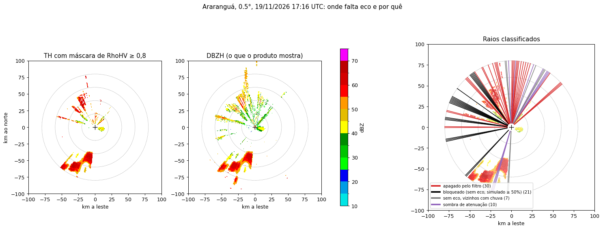
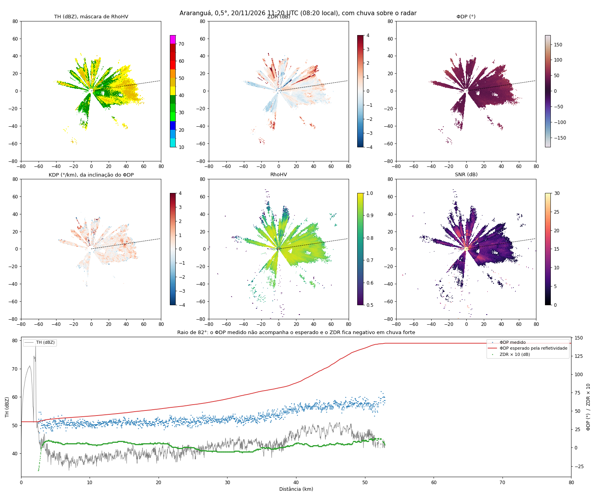
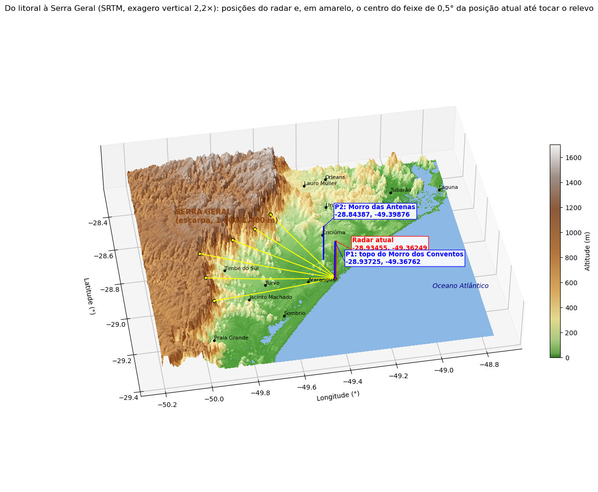

# Radar meteorológico de Araranguá: diagnóstico, bloqueios do feixe e posição alternativa

**Autor:** Dr. Reinaldo Haas. Análises e scripts desenvolvidos com auxílio do Claude (Anthropic).

Relatório técnico no âmbito do Termo de Cooperação Técnica nº 007/SDC/2025 entre a Secretaria de Estado da Proteção e Defesa Civil (SDC) e a Universidade Federal de Santa Catarina (UFSC). O objeto do termo é a troca, integração e acesso a dados hidrológicos e meteorológicos, incluindo os do radar meteorológico, via FTP. As atividades 1.2 e 2.1 do Plano de Ação preveem a comparação com produtos de radar e o uso de dados de radar em tempo real.

Versão 4, 21/11/2026.

**Período de observação.** Este diagnóstico foi feito com poucos dias de dados: os volumes publicados no FTP da Defesa Civil entre 16 e 20/11/2026, dos quais 47 foram usados na análise de sensibilidade e polarimetria e 7 na validação do bloqueio. Os resultados indicam as causas dos problemas e a ordem de grandeza de cada uma, mas devem ser confirmados com um período mais longo, com situações de chuva variadas, e com vistoria no local.

Relevo: MDT e MDS de 1 m do SIGSC (levantamento de 2010–2012) perto do radar e SRTM no restante da região.

## Introdução

Este trabalho começou em 19/11/2026. Houve relatos de chuva forte no sul de Santa Catarina, e tentei usar os dados do radar de Araranguá, publicados no FTP da Defesa Civil, para verificar essas chuvas e os padrões de precipitação na região: localizar as células, estimar a intensidade e acompanhar o deslocamento. Os dados não permitiram fazer isso.

O que as imagens mostravam:
- setores sem eco a oeste e a noroeste, na direção do interior e da Serra Geral, de onde vem boa parte dos sistemas;
- chuva em faixas radiais estreitas ("pente"), com raios cheios ao lado de raios vazios, mudando de um volume para o outro;
- um disco saturado de ~74 dBZ até ~2 km do radar, em todas as direções;
- ecos fixos e fortes na direção de Araranguá e da Serra Geral;
- velocidade radial sem coerência, inclusive dentro da chuva;
- chuva fraca e moderada praticamente ausente além de 20–30 km;
- lacunas de dezenas de minutos entre os volumes publicados.

Na chuva extrema de 20/11 em Laguna, a 76 km do radar, faltavam no FTP os volumes do horário em que a célula chegava à cidade, o radar só via ecos acima de ~45 dBZ àquela distância, e os pluviômetros do Cemaden no município estavam sem dados. Não foi possível estimar quanto choveu. Um pesquisador do INPE havia tentado usar o mesmo radar e considerado os dados inconsistentes.

A partir daí, o estudo passou a investigar a causa de cada defeito com os metadados e as variáveis dos volumes ODIM, a simulação do bloqueio do feixe com o relevo e a vegetação do SIGSC, a especificação publicada pelo fabricante e uma foto do local.

### Problemas encontrados

1. **PRF inadequada para banda X.** Com 400/267 Hz, a velocidade de Nyquist é de 3,2 m/s por PRF, menor que a largura espectral da própria chuva. A velocidade radial sai aleatória (seção 2.1).
2. **Filtro de clutter apagando chuva.** O filtro Doppler depende dessa velocidade e remove raios inteiros de chuva: em mediana, 44% dos raios com chuva a 0,5°. É a principal causa do "pente" e dos setores sem eco que mudam de um dia para o outro (seção 3.1).
3. **Sensibilidade muito abaixo da especificação.** O radar detecta só ~41 dBZ a 50 km, contra 18 dBZ especificados pelo fabricante para um protótipo de potência menor. A chuva fraca e moderada desaparece com a distância, e as variáveis polarimétricas ficam ruidosas (seção 2.2).
4. **ZDR descalibrado** (negativo em chuva) e **zona cega saturada** de 2,2 km, sem o pulso de preenchimento previsto no projeto do equipamento (seções 2 e 4.2).
5. **Antena baixa, num reboque, cercada de obstáculos:** o farol, a 15 m, bloqueia ~141–153° em todas as elevações; poste e fios da rede elétrica cruzam o feixe; a mata do Morro dos Conventos bloqueia a maior parte do feixe de 0,5° a oeste (seções 3.4 e 4).
6. **Atenuação em banda X e radome molhado,** que apagam o que fica atrás das células fortes e reduzem o sinal quando chove sobre o radar (seção 3.1).
7. **Volumes ausentes no FTP:** em 8 h de 20/11, 7 lacunas de mais de 15 min somaram 3 h (37% do tempo).

### Utilidade dos dados na situação atual

- Velocidade radial: não utilizável.
- Refletividade filtrada (DBZH): perde quase metade dos raios com chuva.
- Refletividade total (TH): mostra chuva moderada a forte perto do radar; nada a oeste em baixa elevação; nada no setor do farol.
- ZDR e KDP: não utilizáveis sem calibração e com esse nível de sinal-ruído.
- Estimativa de chuva: sem confiança além de ~20–30 km.

O radar serve para indicar núcleos convectivos fortes, sobretudo a leste, sobre o mar, e ao sul. Não serve para quantificar a chuva nem para acompanhar sistemas que chegam do oeste.

Quase todos os problemas são de configuração, calibração e instalação, não de projeto do equipamento: corrigir a PRF, verificar a sensibilidade com o fabricante, calibrar o ZDR, afastar o reboque do farol e da rede elétrica e elevar a antena.

## Os dados são inconsistentes? Há solução?

Os dados não são inconsistentes ao acaso. Há causas identificadas, cada uma com solução conhecida; elas se somam, e quem usa o arquivo sem conhecê-las vê um radar que não concorda com nada.

| O que o usuário vê | Causa | Solução | Quem resolve | Dificuldade |
|---|---|---|---|---|
| Velocidade radial sem sentido | PRF de 400/267 Hz em banda X (seção 2.1) | PRF de 1200/900 Hz | fabricante / operador | baixa |
| Raios de chuva apagados no DBZH; setores "bloqueados" que mudam de um dia para outro | filtro de clutter com velocidade aleatória (seção 3.1) | mudar a PRF; até lá, usar TH com máscara de RhoHV | operador / usuário | baixa |
| Chuva fraca ausente; só núcleos de 30–50 dBZ | sensibilidade 22–29 dB abaixo da especificação (seção 2.2) | diagnóstico do transmissor, da compressão de pulso, das perdas e do receptor | fabricante | média a alta |
| RhoHV baixo em chuva; ZDR negativo; ΦDP ruidoso | SNR de 5–8 dB em chuva moderada; ZDR sem calibração (seções 2.2 e 4.2) | corrigir a sensibilidade; varredura vertical para o ZDR | fabricante / operador | média |
| Disco de ~74 dBZ em volta do radar | zona cega de 2,2 km (seção 2) | pulso curto de preenchimento | fabricante | baixa |
| Oeste quase sem eco a 0,5° e 1,4° | mata do Morro dos Conventos e do entorno da antena (seção 4) | torre de 25 m | Defesa Civil | média |
| Eco fixo forte a 268–271° | clutter de Araranguá e da Serra Geral visto por uma abertura na mata (seção 3) | filtro de clutter funcionando (depende da PRF) | operador | baixa |
| Séries com lacunas | volumes ausentes no FTP | rever a transmissão ao FTP | Defesa Civil | baixa |

### Exemplo: Laguna, 20/11/2026, 8–9 h

Em Laguna foi relatada chuva extrema entre 8 e 9 h, associada à chegada da piscina fria (*cold pool*) de um Complexo Convectivo de Mesoescala (CCM) que, nas imagens de satélite, apresentava número excepcional de descargas elétricas.

O radar mostra, às 08:18, chuva de 40–55 dBZ numa faixa ao longo da costa entre Jaguaruna e Laguna e, às 08:57, um núcleo de 55–65 dBZ a 1,4° encostado em Laguna pelo sul, com ~15 × 20 km. Não mostra:
- o intervalo entre 08:21 e 08:57, ausente no FTP, quando o núcleo entrava na cidade;
- a chuva estratiforme do CCM e a frente de rajada (10–30 dBZ), abaixo do limite de detecção a 76 km (~45 dBZ);
- o sistema sobre o continente, a oeste e noroeste, por causa do bloqueio e do filtro de clutter;
- a intensidade real, reduzida pela atenuação da chuva entre o radar e Laguna, que o ΦDP ruidoso não permite corrigir.

Os 5 pluviômetros do Cemaden em Laguna estavam sem dados naquele dia.

**Quanto à solução:** a configuração (PRF, transmissão ao FTP, calibração do ZDR) resolve a maior parte das inconsistências percebidas pelo usuário, e a torre de 25 m resolve o bloqueio a oeste. A questão em aberto é a sensibilidade. Ela está 22–29 dB abaixo da especificação do fabricante (seção 2.2), o que torna mais provável um defeito ou erro de configuração que um limite do equipamento. Se for defeito, o radar passa a ver chuva fraca até ~60–80 km. Se for limite do equipamento, ele continua útil para chuva moderada a forte até ~40–50 km, como complemento local do radar de banda S do Morro da Igreja. Por isso, o primeiro passo é obter do fabricante a especificação de sensibilidade e um teste de potência e ruído; a decisão sobre a torre vem depois.

**Para quem usa os dados hoje:** usar TH, não DBZH, com máscara de RhoHV ≥ 0,8; descartar os 2,2 km iniciais; não usar a velocidade nem o ZDR; tratar 240–340° a 0,5° e 1,4° como bloqueado; e considerar que ausência de eco além de ~20 km não significa ausência de chuva.

## 1. O radar

| Item | Valor (metadados ODIM) |
|---|---|
| Equipamento | EEC Ranger, software EDGE 6.2.3, banda X (λ = 3,19 cm) |
| Feixe | 2,18° (H) × 2,20° (V); ganho 36,2 dB; potência nominal 410 W |
| Varredura | 5 elevações (0,5°, 1,4°, 2,4°, 3,4°, 4,5°), 360 raios × 3840 bins de 31,25 m (120 km), a cada ~5 min |
| PRF | 400 / 267 Hz (dual-PRF 3:2), Nyquist estendido 6,38 m/s |
| Posição | -28,934548, -49,362490; chão a 67,8 m (MDT do SIGSC); antena ~3 m acima do chão |

## 2. Configuração e processamento

**PRF baixa.** Nos ecos de chuva (RhoHV ≥ 0,95 e SNR ≥ 20 dB), a velocidade varia entre raios vizinhos tanto quanto um valor sorteado, e o SQI fica em 0,1–0,3. O filtro de clutter Doppler remove 73% do eco bruto a 0,5° e 25% a 2,4–4,5°, onde quase não há clutter.

**Zona cega de 2,2 km.** Até 2,17 km todos os raios ficam saturados em ~74 dBZ: é o receptor captando o pulso transmitido (14,3 µs de ida e volta). Não há medida nesse disco.

### 2.1 PRF recomendada

Em banda X, a velocidade de Nyquist é V = λ·PRF/4, o alcance sem ambiguidade é R = c/(2·PRF) e a coerência entre pulsos para uma chuva com largura espectral σ é SQI ≈ exp(−8π²σ²/(λ·PRF)²).

| | Atual: 400 / 267 Hz | Recomendado: 1200 / 900 Hz |
|---|---|---|
| Nyquist de cada PRF | 3,2 / 2,1 m/s | 9,6 / 7,2 m/s |
| Nyquist estendido (dual-PRF) | 6,4 m/s | ~29 m/s |
| Alcance sem ambiguidade | 375 / 562 km | 125 / 167 km |
| SQI com σ = 2 m/s | 0,14 | 0,81 |
| Pulsos por raio (mesma rotação) | 1× | 3× |

Com 400 Hz, o intervalo de Nyquist é menor que a largura espectral de uma chuva comum (1–3 m/s), e os pulsos sucessivos ficam descorrelacionados. A velocidade sai aleatória, ventos de 10–40 m/s dobram várias vezes, e o entalhe do filtro de clutter ocupa boa parte do intervalo, apagando a chuva dobrada para perto de zero. O alcance de 375 km não traz vantagem, já que o radar processa 120 km.

O critério é usar a maior PRF cujo alcance sem ambiguidade cubra os 120 km processados: 1200 Hz (125 km). A razão 4:3 (1200/900 Hz) dá ~29 m/s de Nyquist estendido. A faixa do equipamento, segundo o fabricante, é de 200 a 2400 Hz.

### 2.2 Sensibilidade

A menor refletividade detectada (Zmin = TH − SNR) foi medida em 47 volumes, a 2,4°, onde há pouco clutter:

| Distância | Zmin | Zmin reduzido a 1 km |
|---|---|---|
| 5 km | 24 dBZ | 10 dBZ |
| 20 km | 30 dBZ | 4 dBZ |
| 40 km | 38 dBZ | 6 dBZ |
| 60 km | 44 dBZ | 8 dBZ |
| 100 km | 52 dBZ | 12 dBZ |

Um radar de banda X costuma detectar −20 a −30 dBZ a 1 km; aqui o limite é de ~5–10 dBZ.

A EEC publicou as especificações do protótipo Ranger-X1 (AMS, 94ª reunião anual, 2014): 100 W, pulso LFM de 67 µs comprimido com pulso curto de preenchimento de 2 µs, sensibilidade de 18 dBZ a 50 km (SNR 0 dB), PRF de 200 a 2400 Hz. Com 410 W, o mesmo projeto deveria chegar a ~12 dBZ a 50 km, ou ~19 dBZ descontando o pulso mais curto que a zona cega deste radar sugere. O medido é ~41 dBZ: 22–29 dB abaixo. A zona cega saturada indica também que o pulso de preenchimento não está ativo.

Consequências: a chuva abaixo de 30 dBZ não aparece além de ~20 km, nem a de 40 dBZ além de ~40 km; em chuva de 35–45 dBZ o SNR fica em 5–8 dB, o RhoHV cai para 0,88–0,93 e o ZDR e o ΦDP ficam enviesados e ruidosos.

Causas possíveis, a verificar com o fabricante: potência transmitida abaixo da nominal, compressão de pulso desligada ou com defeito (20–30 dB num transmissor de estado sólido), perdas no guia de onda ou na junta rotativa, ruído do receptor ou constante de calibração errada.

## 3. Bloqueios e ecos fixos observados

Fração de pontos com eco (TH ≥ 10 dBZ, 5–40 km), média de 7 volumes:

| Setor | 0,5° | 1,4° | Causa provável |
|---|---|---|---|
| ~215–300° | sem eco ou forte falta | 60–100% de falta em 255–310° | mata do Morro dos Conventos |
| 321–324° | 2–5% (vizinhos 40–90%) | 0–1% | mata na crista a NW ou objeto perto da antena |
| 352–356° | 59–78% (vizinhos 95%) | 0–0,5% | objeto perto da antena (poste ou fios) |
| a partir de 146° | 0% | — | farol |

A 268–271° há eco fixo forte de 2 a 14 km (planície e cidade de Araranguá) e de 42 a 58 km (escarpa da Serra Geral), com RhoHV de 0,81–0,87 e SQI de 0,11: alvos fixos vistos por uma abertura na mata, na direção da estrada.

### 3.1 Por que os setores sem eco mudam de um dia para outro

O bloqueio pelo relevo e pela mata é fixo. A variação entre horários vem de outras causas (47 volumes):

| Causa | 0,5° | 1,4° |
|---|---|---|
| Raios com chuva no TH apagados no DBZH pelo filtro de clutter | mediana de 37 por volume (44% dos raios com chuva) | mediana de 9 (21%) |
| Sombras de atenuação atrás de núcleos ≥ 45 dBZ | mediana de 6, até 17 | mediana de 1, até 21 |
| Volumes com chuva sobre o radar (radome molhado) | 18 de 47 | — |

O filtro de clutter é o principal responsável: como a velocidade é aleatória, os raios apagados mudam a cada volume, e em produtos feitos com o DBZH aparecem setores "bloqueados" que vão e vêm. Em dias de chuva forte somam-se as sombras de atenuação e a atenuação no radome molhado, que, com a sensibilidade já baixa, eliminam a chuva moderada a dezenas de quilômetros.

### 3.2 Um volume, raio a raio: 19/11/2026, 17:16 UTC

| Classe | 0,5° | 1,4° |
|---|---|---|
| Raios com chuva no TH | 154 | 137 |
| Apagados pelo filtro de clutter | 30 | 9 |
| Sem eco, vizinhos com chuva, bloqueio simulado ≥ 50% | 21 | 5 |
| Sem eco, vizinhos com chuva, sem bloqueio simulado | 7 | 17 |
| Sombra de atenuação | 10 | 6 |

As faixas radiais a noroeste e ao norte são chuva vista só nos raios que passam pelos vãos da mata e dos obstáculos próximos; os vizinhos são bloqueados ou apagados pelo filtro. Os raios sem eco e sem bloqueio simulado indicam obstáculos a menos de 100 m da antena, que a simulação não alcança.

### 3.3 Interferência de rádio

O radar opera em ~9,4 GHz. Wi-Fi (2,4, 5 e 6 GHz) não interfere nessa faixa. Os candidatos em banda X são os radares de navegação de barcos (9,3–9,5 GHz), relevantes para um radar na costa, outros radares de banda X e enlaces de micro-ondas. Uma interferência aparece como um raio estreito com eco em todo o alcance, inclusive em céu claro, com dBZ que sobe com a distância (a potência recebida é constante), RhoHV baixo e, no caso de barcos, mudando de azimute entre volumes.

Foram examinados todos os raios das 5 elevações em 52 volumes de 16 a 20/11, procurando raios com eco em mais da metade do trecho de 40 a 118 km e vizinhos (±3–5°) vazios. Não há interferência:

- O raio de 349,5° a 0,5° aparece em quase todos os volumes, mas o eco vai de 10 a ~80 km e para; a 1,4°, só aparece entre 60 e 80 km, na Serra Geral, e o RhoHV é de 0,3–0,6. É eco de terreno visto por uma abertura na mata, como o de 268–271°.
- Os demais candidatos aparecem uma vez cada: são chuva (RhoHV 0,85–0,9) ou trechos de áreas de chuva com falhas ao longo do raio e o mesmo padrão nos raios vizinhos. Nenhum forma uma linha contínua até o fim do alcance.

O raio de 349,5° também mostra a perda no radome molhado: em 20/11, das 11:06 às 11:57 UTC, com chuva forte sobre o radar, o eco de terreno desaparece além de 30 km nesse raio e nos vizinhos.

O teste tem limites. Com a sensibilidade 22–29 dB abaixo da especificação (seção 2.2), uma interferência fraca fica abaixo do ruído. Radares de barco são intermitentes, e 52 volumes em 5 dias podem não registrá-los. O teste definitivo é uma varredura só de recepção, com o transmissor desligado, feita pelo fabricante ou pelo operador.

### 3.4 O local da antena

Uma foto do local mostra que o radar é uma unidade móvel: o radome está sobre um reboque, com a antena a ~3–4 m do chão, o que confirma a calibração da simulação. O farol está a ~15 m, a 147°; com ~3 m de diâmetro e ~15 m de altura, ocupa ~12° de azimute (~141–153°) até ~35–45° de elevação e bloqueia esse setor em todas as elevações. Um poste e fios da rede elétrica passam ao lado do radome e são os candidatos para os setores 321–324° e 352–356°. A mata em volta tem a altura do radome ou mais.

Por ser móvel, o radar pode ser reposicionado sem obra civil grande: afastado pelo menos ~50–100 m do farol, num ponto sem fios por perto, ou levado para uma posição mais alta. A posição do poste e dos fios precisa ser medida no local.

## 4. Simulação do bloqueio

Método: bloqueio parcial do feixe (Bech et al., 2003), Terra de raio efetivo 4/3, feixe de 2,2°, bloqueio acumulado ao longo do raio, a partir de 100 m da antena (campo próximo). A superfície é o MDS de 1 m do SIGSC (terreno, mata e construções de 2010–2012) e, fora dele, o MDT com 15 m de mata.

As manchas altas a sudoeste do Morro dos Conventos, centradas em -28,9411, -49,3701, não são morros nem erro do SIGSC. O terreno (MDT) ali é uma encosta lisa, de 29 a 48 m. As manchas são copas de árvores de 20–30 m, chegando a 32 m. A imagem de satélite atual mostra mata densa no mesmo lugar, entre casas, possivelmente pinus ou eucalipto. Essa mata fica a ~1 km do radar, a 225–235°, e o topo das copas, a 65–72 m de altitude, chega à altura da antena atual (~71 m), por isso bloqueia parte do setor sudoeste. Na proposta 1 ela fica a ~400–500 m, e a antena numa torre de 25 m (~94 m) passa acima das copas.

O levantamento é anterior ao radar, e a mata cresceu desde então. A calibração com os volumes observados testou crescimentos de 0, 3 e 6 m:

| Superfície | Oeste a 30 km, simulado (0,5° / 1,4° / 2,4°) | Correlação com a falta de eco (0,5° / 1,4° / 2,4°) |
|---|---|---|
| MDS de 2012 | 37% / 8% / 1% | 0,26 / 0,19 / 0,12 |
| MDS + 3 m | 57% / 19% / 4% | 0,35 / 0,30 / 0,09 |
| MDS + 6 m | 72% / 39% / 13% | 0,36 / 0,34 / 0,23 |

O melhor ajuste usa a mata 6 m mais alta que em 2012, com a antena ~3 m acima do chão. Mesmo assim, a 1,4° o simulado (39%) fica abaixo da falta de eco observada (60–100%), o que indica obstáculos também nos primeiros 100 m da antena: árvores do terreno, o poste e os fios.

O resultado praticamente não depende da refração: com raio efetivo de 1 a 4 vezes o da Terra, o bloqueio a oeste não muda, porque vem de obstáculos a menos de 1 km. Os prédios de Araranguá (35–40 m, a 10–12 km) tapam no máximo ~13% do feixe de 0,5° em faixas de décimos de grau; causam clutter, não bloqueio.

## 4.1 Bloqueio pelos dados polarimétricos

A fase diferencial ΦDP e sua derivada, o KDP, não dependem da potência recebida. Comparando o ΔΦDP medido com o esperado pela refletividade (autoconsistência; Giangrande & Ryzhkov, 2005), obtém-se a perda de potência por azimute. Aplicado a 47 volumes, o método deu resultado inconclusivo: só 2.173 raios tinham chuva suficiente, e a perda estimada oscila de −10 a +7 dB entre setores vizinhos, sem relação com os bloqueios conhecidos. A causa é o SNR baixo da seção 2.2.

O ZDR mediano na chuva de 35–45 dBZ é de −0,3 a −0,4 dB, quando deveria ser de +0,5 a +1,5 dB: há erro de calibração de pelo menos ~1 dB, somado ao viés do SNR baixo. A correção é uma varredura vertical (*birdbath*) em chuva fraca.

## 4.2 Chuva forte sobre o radome: KDP e ZDR

Em banda X, a chuva forte é quando o radar mais falha: a água no radome atenua o sinal em todas as direções, cada célula intensa apaga o que está atrás dela, e a refletividade subestima a chuva nos eventos extremos. Na manhã de 20/11, com o CCM sobre o litoral sul, chovia sobre o radar em 18 dos 47 volumes analisados.

A solução conhecida é a polarimetria. O ΦDP e o KDP medem fase, não potência, e não são afetados pela atenuação, pelo radome molhado, pela calibração de Z nem pelo bloqueio parcial. Com o ΦDP corrige-se a atenuação de Z e ZDR (ΔZ ≈ 0,28·ΔΦDP em banda X); com o KDP estima-se a chuva forte diretamente (R ≈ 19,6·KDP^0,82 mm/h); o ZDR calibrado completa a estimativa. A resposta à chuva forte sobre o radome é fazer o KDP e o ZDR funcionarem.

Volume de 20/11, 11:20 UTC (08:20 local), com chuva sobre o radar:

| Indicador (203 mil gates de chuva de 35–55 dBZ a 0,5°) | Medido | Esperado |
|---|---|---|
| SNR mediano | 8,6 dB | > 20–30 dB |
| RhoHV mediano | 0,94 | ≥ 0,97–0,99 |
| ZDR mediano | 0,0 dB (49% negativo) | +0,5 a +2 dB |
| KDP mediano | 0,24 °/km (19% negativo) | ~0,57 °/km para essa refletividade |
| Ruído do ΦDP | 2,8° | < 1–2° |

No raio de 82°, com 40–50 dBZ por 50 km, a refletividade implica um aumento de ~105° no ΦDP; o medido é de ~20°.

Isso não se corrige em processamento. O ΦDP e o Z não fecham entre si, e não há como saber qual está errado; o desvio do ZDR varia de gate para gate com o SNR; com SNR de ~8 dB e poucos pulsos por raio, o KDP sai negativo em quase um quinto da chuva. A correção precisa ser feita no equipamento:
1. recuperar a sensibilidade, para levar o SNR em chuva a 20–30 dB;
2. PRF de 1200/900 Hz;
3. calibrar o ZDR e conferir a constante de Z;
4. revisar o processamento do ΦDP no EDGE.

## 5. Posições alternativas

| Posição | Latitude | Longitude | Chão (MDT) | Distância / azimute do radar atual |
|---|---|---|---|---|
| Radar atual | -28,934548 | -49,362490 | 67,8 m | — |
| Topo da colina a NW | -28,925236 | -49,370698 | 67,2 m | 1,31 km / 322° |
| Proposta 1: topo do Morro dos Conventos | -28,937250 | -49,367620 | 69,2 m | 0,58 km / 239° |
| Proposta 2: Morro das Antenas | -28,843869 | -49,398756 | 255,1 m | 10,66 km / 341° |

O chão do radar e os topos do Morro dos Conventos e da colina estão praticamente na mesma altitude. O que bloqueia é a mata, não o relevo; uma antena 25 m acima do chão passa sobre ela em qualquer um desses pontos.

Bloqueio simulado (MDS + 6 m de mata):

| Posição | Torre | Média a 30 km (0,5° / 1,4°) | Média a 60 km (0,5° / 1,4°) | Oeste a 30 km (0,5° / 1,4°) |
|---|---|---|---|---|
| Atual | antena atual (~3 m) | 37% / 18% | 45% / 21% | 72% / 39% |
| Atual | 15 m | 17% / 0% | 33% / 8% | 23% / 1% |
| Atual | 25 m | 14% / 0% | 32% / 7% | 18% / 0% |
| Topo da colina a NW | 25 m | 15% / 0% | 33% / 8% | 19% / 0% |
| Proposta 1 | 25 m | 14% / 0% | 32% / 8% | 17% / 0% |
| Proposta 2 | 25 m | 9% / 1% | 32% / 10% | 15% / 1% |
| Proposta 2 | 35 m | 6% / 0% | 29% / 9% | 14% / 1% |

### 5.1 Obstáculos e teste das propostas

| # | Obstáculo | Latitude | Longitude | Altura | Distância / azimute do radar atual |
|---|---|---|---|---|---|
| 1 | Farol do Morro dos Conventos | -28,934662 | -49,362405 | ~15 m | 15 m / 147° |
| 2 | Poste e fios da rede elétrica | a medir | a medir | | ao lado do radome |
| 3 | Crista com mata (setor 321–324°) | -28,929587 | -49,366918 | 10–17 m | 699 m / 322° |
| 4 | Colina a NW, com mata | -28,925236 | -49,370698 | 8–15 m | 1,31 km / 322° |
| 5 | Mata do topo do Morro dos Conventos | -28,937250 | -49,367620 | ~5–10 m | 583 m / 239° |
| 6 | Morro com mata a oeste | -28,939924 | -49,471553 | ~15 m | 10,65 km / 267° |
| 7 | Torres e mata do Morro das Antenas | em volta da proposta 2 | | até ~21 m | 250 m a NNE da proposta 2 |
| 8 | Mata alta a SW do Morro dos Conventos | -28,941068 | -49,370137 | 20–32 m | 1,04 km / 226° |

| Posição | 0,5°, média a 10 / 30 / 60 km | 0,5°, oeste a 30 / 60 km | 1,4°, média a 30 / 60 km | Raios ≥ 50% bloqueados a 30 km (0,5° / 1,4°) |
|---|---|---|---|---|
| Atual (antena ~3 m) | 31% / 37% / 45% | 72% / 90% | 18% / 21% | 107 / 62 |
| Proposta 1 (25 m) | 3% / 14% / 32% | 17% / 71% | 0% / 8% | 5 / 0 |
| Proposta 2 (25 m) | 4% / 9% / 32% | 15% / 76% | 1% / 10% | 17 / 3 |

As duas propostas eliminam o bloqueio próximo: a 30 km o feixe de 1,4° fica livre em praticamente todas as direções, e o de 0,5° passa de 107 raios muito bloqueados para 5 (proposta 1) e 17 (proposta 2).
- **Proposta 1** fica a 583 m do radar atual, no mesmo morro, perto da energia e da comunicação existentes. O único setor bloqueado a 30 km é o de 342–346°, onde está o Morro das Antenas.
- **Proposta 2** tem a melhor cobertura média a 30 km, mas estruturas de ~21 m a 250 m a NNE (torres de comunicação ou mata) bloqueiam 15–30°; ali a torre precisa de 30–35 m.

Como o radar é móvel, a proposta 1 é a de menor custo.

**Do litoral à Serra Geral.** O centro do feixe de 0,5° da posição atual foi seguido sobre o relevo (SRTM) até tocá-lo, sem considerar a mata próxima:

| Azimute | Onde o centro do feixe de 0,5° toca o relevo |
|---|---|
| 230–245° (Sombrio, Praia Grande) | não toca até 80 km |
| 250–290° (Turvo, Jacinto Machado, Timbé do Sul) | escarpa da Serra Geral, a 53–64 km (700–1.050 m) |
| 295–335° (Criciúma, Urussanga, Lauro Müller) | morros e sopé da Serra, a 35–50 km (520–710 m) |
| 340° | Morro das Antenas, a 10 km |

Mesmo com a antena livre da mata, a 0,5° o radar só vê até ~50–60 km a oeste; além disso, o produto de chuva deve usar 1,4° ou mais. Isso vale para todas as posições estudadas.

## 6. Limitações

- O diagnóstico se baseia em poucos dias de dados (16 a 20/11/2026). Os números de sensibilidade, filtro e bloqueio devem ser confirmados com um período mais longo e com tipos de chuva variados.
- A validação do bloqueio usa 7 volumes, com chuva em lugares diferentes; a correlação com o observado é modesta (~0,35).
- O MDS é de 2010–2012. O crescimento da mata (6 m no ajuste) é uniforme na simulação, e construções posteriores não aparecem.
- Obstáculos a menos de 100 m da antena (farol, poste, fios, árvores do terreno) só podem ser avaliados no local.
- As posições precisam de visita: acesso, posse da área, energia, comunicação e vegetação real.

## 7. Próximos passos

1. Pedir ao fabricante a mudança da PRF para 1200/900 Hz e a ativação do pulso de preenchimento.
2. Pedir ao fabricante a verificação da sensibilidade: potência transmitida, compressão de pulso, perdas, ruído do receptor e constante de calibração.
3. Calibrar o ZDR por varredura vertical, conferir o alinhamento em azimute por varredura do Sol e fazer uma varredura só de recepção, com o transmissor desligado, para descartar interferência.
4. Vistoria no local: medir a posição do poste e dos fios e fotografar os setores 260–300°, 321–324° e 352–356° a partir da antena.
5. Afastar o reboque do farol e da rede elétrica e, em seguida, decidir entre a torre de 25 m no Morro dos Conventos e a de 30–35 m no Morro das Antenas.
6. Repetir o diagnóstico com algumas semanas de dados depois dos itens 1–3, incluindo a medida do bloqueio real pelo ΦDP.

## 8. Como reproduzir

Scripts em `radar-sc/`:

| Script | Função |
|---|---|
| `baixar_ftp_sc.py` | baixa volumes do FTP |
| `diagnostico_odim.py` | qualidade por elevação (filtro, RhoHV, velocidade, SQI) |
| `relevo.py`, `relevo_sigsc.py`, `simular_bloqueio.py` | relevo (SRTM e SIGSC) e simulação do bloqueio |
| `analise_mds.py` | calibração com o MDS, setores e prédios |
| `analise_polarimetrica.py` | autoconsistência Z–ΦDP, ZDR e sensibilidade por distância |
| `setores_por_volume.py`, `raios_bloqueados.py` | raios apagados pelo filtro, sombras de atenuação e classificação raio a raio |
| `verificar_interferencia.py` | busca de raios de interferência de rádio |
| `figura_polarimetria_volume.py`, `figura_laguna.py`, `chuva_ponto.py` | polarimetria de um volume; exemplo de Laguna; chuva num ponto |
| `posicoes_obstaculos.py`, `figuras_posicoes_latlon.py`, `mapa3d_serra_geral.py` | posições, obstáculos, bloqueio por posição e mapas 3D |
| `gerar_kmz_3d.py`, `gerar_esp_earth_studio.py` | modelo 3D e visadas para o Google Earth; projeto do Google Earth Studio |

Referências:
- Bech, J., Codina, B., Lorente, J., Bebbington, D. (2003). The sensitivity of single polarization weather radar beam blockage correction to variability in the vertical refractivity gradient. *J. Atmos. Oceanic Technol.*, 20, 845–855.
- Giangrande, S. E., Ryzhkov, A. V. (2005). Calibration of dual-polarization radar in the presence of partial beam blockage. *J. Atmos. Oceanic Technol.*, 22, 1156–1166.
