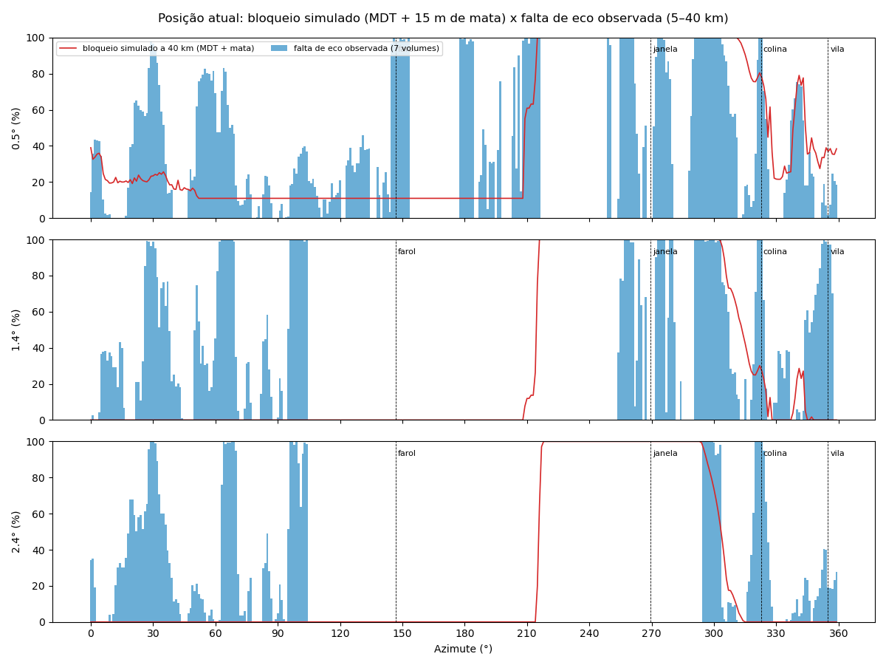
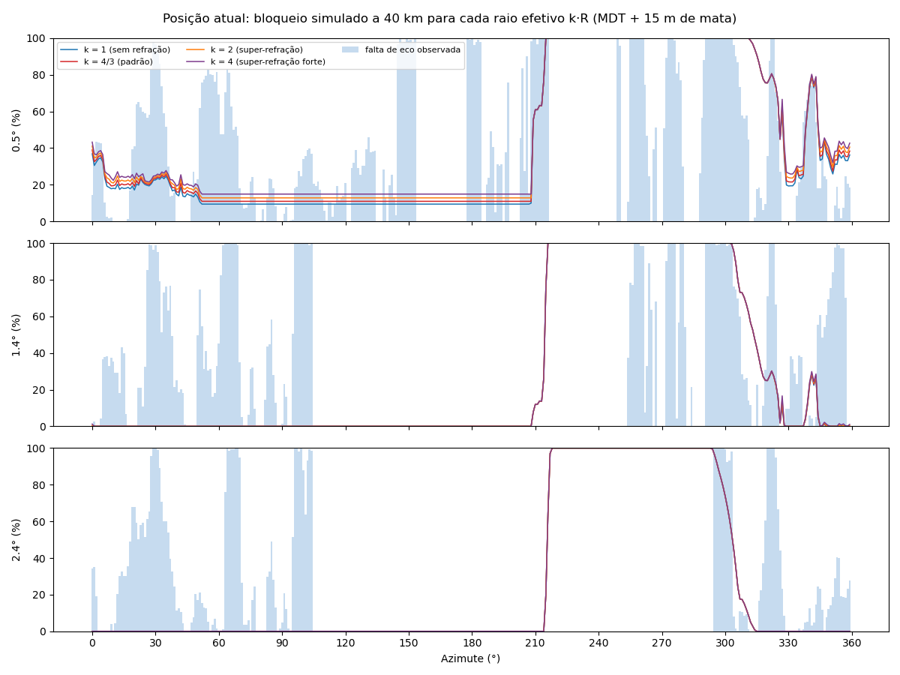
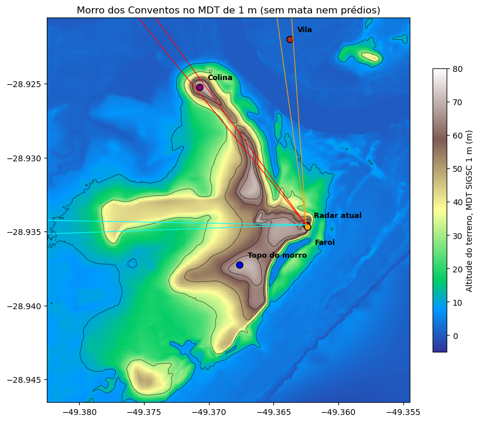

# Radar meteorológico de Araranguá: diagnóstico, bloqueios do feixe e posição alternativa

Versão 2, 19/11/2026. Relevo: **MDT de 1 m do SIGSC** (folhas SH-22-X-B-IV-3, SH-22-X-A-VI-4 e SH-22-X-B-IV-1) e SRTM fora delas.
Dados: 7 volumes do FTP da Defesa Civil de SC, de 16/11 23:58 a 19/11 23:36 UTC.

## Resumo

1. **A configuração do radar inutiliza o Doppler.** A PRF de 400/267 Hz em banda X dá velocidade de Nyquist de 6,4 m/s. A velocidade sai aleatória e o filtro de clutter, que depende dela, apaga raios inteiros de chuva.
2. **Quem bloqueia o oeste é a mata do Morro dos Conventos, não o relevo.** No MDT, o topo do morro fica só 1,4 m acima do chão do radar, e só com o terreno o oeste fica livre a 1,4°. Com 15–20 m de mata sobre o terreno, a simulação reproduz o que os volumes mostram: no setor oeste (240–340°), a 30 km, 74–80% do feixe de 1,4° e 87–90% do de 0,5° ficam bloqueados. É a direção do interior e da Serra Geral.
3. **Araranguá aparece como eco de clutter, não como bloqueio.** Há eco forte e fixo a 268–271°, de 2 a 14 km (planície, estrada e cidade) e de 42 a 58 km (Serra Geral). Ele só aparece por uma "janela" de ~4°, provavelmente a abertura da estrada na mata. Prédios a 12 km não bloqueiam o feixe de forma relevante: mesmo um prédio de 80 m taparia no máximo ~32% do feixe de 0,5° e ~8% do de 1,4°, num azimute estreito.
4. **Uma torre de 25 m resolve o oeste, inclusive no lugar atual.** No MDT, o chão do radar (67,8 m), o topo do Morro dos Conventos (69,2 m) e o topo da colina a NW (67,2 m) estão praticamente na mesma altura. O que bloqueia é a mata, então basta pôr a antena **25 m acima do chão** (pelo menos 5 m acima de mata de 20 m), em qualquer um desses pontos. A 30 km, no setor oeste, o bloqueio a 1,4° cai de 74% para 0–1%.

   | Antena 25 m acima do chão, mata de 15 m | Média, 30 km (0,5° / 1,4°) | Média, 60 km (0,5° / 1,4°) | Oeste, 30 km (0,5° / 1,4°) |
   |---|---|---|---|
   | Atual, -28,93455, -49,36249, antena como está hoje (~3 m) | 42% / 28% | 47% / 31% | 87% / 74% |
   | **Atual, -28,93455, -49,36249, com torre de 25 m** | **14% / 0%** | **32% / 7%** | **18% / 0%** |
   | Topo da colina a NW, -28,92524, -49,37070 | 15% / 0% | 33% / 8% | 19% / 0% |
   | Topo do Morro dos Conventos, -28,93725, -49,36762 | 14% / 0% | 32% / 8% | 17% / 0% |
   | Morro das Antenas, -28,84387, -49,39876 | 6% / 0% | 30% / 9% | 15% / 1% |

   Erguer a antena no lugar atual é a opção mais simples: dá o mesmo resultado que ir para a colina ou para o topo do Conventos, e a 25 m a antena também fica acima do farol. O Morro das Antenas (255 m, 10,7 km a 341° do radar atual) é um pouco melhor perto do radar e, pelo nome, provavelmente já tem acesso e energia (a confirmar). Lá, a torre do radar precisa ficar longe das torres de comunicação existentes, ou acima delas, porque elas também bloqueiam o feixe. O topo do Morro dos Conventos fica a 580 m do radar atual, no mesmo terreno.

## 1. O radar

| Item | Valor (metadados ODIM) |
|---|---|
| Equipamento | EEC Ranger, software EDGE 6.2.3, banda X (λ = 3,19 cm) |
| Feixe | 2,18° (H) × 2,20° (V); ganho 36,2 dB; potência nominal 410 W |
| Varredura | 5 elevações (0,5°, 1,4°, 2,4°, 3,4°, 4,5°), 360 raios × 3840 bins de 31,25 m (120 km), a cada ~5 min |
| PRF | 400 / 267 Hz (dual-PRF 3:2), Nyquist 6,38 m/s |
| Posição real | -28,934548, -49,362490 |
| Posição nos arquivos | -28,9346, -49,3627 (21 m da real); altitude declarada 46 m |
| Chão no MDT do SIGSC | 67,8 m; o melhor ajuste aos volumes põe a antena ~3 m acima dele |

As altitudes medidas no Google Earth (antena a 49 m, colina a 57 m) ficam ~10–19 m abaixo do MDT nos mesmos pontos. O relatório usa o MDT do SIGSC, que é o levantamento oficial com precisão altimétrica de 1 m.

## 2. Problemas de configuração e processamento

**PRF baixa.** Com PRF de 400 Hz em banda X, mesmo uma chuva com largura espectral de 1,5–2 m/s dá SQI de 0,1–0,3. Nos ecos de chuva (RhoHV ≥ 0,95 e SNR ≥ 20 dB), a velocidade varia entre raios vizinhos tanto quanto um valor sorteado (mediana de 2,7–3,7 m/s, contra 3,7 m/s de um valor aleatório). O filtro de clutter Doppler remove 73% do eco bruto a 0,5° e 25% a 2,4–4,5°, onde quase não há clutter. A PRF de 400 Hz dá 375 km de alcance sem ambiguidade, mas o radar processa só 120 km.

**Zona cega de 2,2 km.** Até 2,17 km todos os raios, em todas as direções, ficam saturados em ~74 dBZ. É o receptor captando o pulso transmitido (14,3 µs de ida e volta). Não há medida real nesse disco.

**Clutter.** Os ecos de 30 dBZ ou mais têm RhoHV mediano de 0,54–0,71 a 0,5°, valor de mar e relevo, não de chuva.

**Recomendação ao fabricante:** PRF próxima de 1200/900 Hz (dual-PRF 4:3). Isso dá Nyquist de 9,6 e 7,2 m/s, ~29 m/s com a extensão dual-PRF, e 125 km de alcance sem ambiguidade, que cobre os 120 km processados. Com velocidade confiável, o filtro de clutter volta a funcionar.

## 3. Bloqueios e ecos fixos observados

Fração de pontos com eco (TH ≥ 10 dBZ, 5–40 km), média dos 7 volumes:

| Setor | 0,5° | 1,4° | 2,4° | 3,4° | 4,5° | Causa provável |
|---|---|---|---|---|---|---|
| ~215–300° | sem eco ou forte falta | 60–100% de falta em 255–310° | falta em 295–305° | — | — | mata do topo do Morro dos Conventos |
| 321–324° | 2–5% (vizinhos 40–90%) | 0–1% | 0–1% | 0–2% | 6–7% (vizinhos 8–9%) | mata alta na colina a 1,3 km, ou objeto perto da antena |
| 352–356° | 59–78% (vizinhos 95%) | 0–0,5% (vizinhos 9–21%) | normal | normal | normal | não explicado (vila e árvores ficam abaixo do feixe) |
| a partir de 146° | 0% (antes 8–18%) | — | — | — | — | farol (15 m, topo 8 m acima da antena); depois vem o mar sem eco |

**Ecos fixos a 268–271°** (≥ 35 dBZ em 6 dos 7 volumes):

| Distância | 0,5° | 1,4° | 2,4° | O que é |
|---|---|---|---|---|
| 2–14 km | 91–100% dos pontos | 70–100% | ~0% | planície, Rua Morro dos Conventos, rede elétrica e cidade de Araranguá (centro a 270°, 12 km) |
| 14–42 km | 0–20% | 0% | 0% | — |
| 42–58 km | 49–100% | 32–100% | 0% | escarpa da Serra Geral |

Nesses pontos o RhoHV mediano é de 0,81–0,87 e o SQI de 0,11: alvos fixos, não chuva. Não é interferência de transmissor, que apareceria em todo o alcance. Nos setores vizinhos quase não há eco fixo (0,0–0,7%). A explicação mais provável é uma abertura na mata do morro, na direção da estrada (a Rua Morro dos Conventos sai a ~264°), que deixa o feixe passar só ali.

## 4. Simulação do bloqueio

Método: bloqueio parcial do feixe (Bech et al., 2003), com Terra de raio efetivo 4/3, feixe de 2,2° e bloqueio acumulado ao longo do raio.

**Relevo:**
- MDT de 1 m do SIGSC nos primeiros 2 km de cada posição.
- O mesmo MDT reduzido a 5 m, guardando o máximo de cada bloco (o lado seguro), no resto das três folhas.
- SRTM de 30 m fora delas.

As folhas 1:10.000 do SIGSC não declaram nodata e têm nas bordas uma moldura de 0 e −9999 m que se sobrepõe ~270 m à folha vizinha. Na primeira montagem, essa moldura aparecia como uma faixa de 0 m cortando o morro a −49,376° (emenda entre SH-22-X-B-IV-3-SO-D e SE-C). O mosaico agora usa o maior valor nas sobreposições, o que elimina a faixa. Refeitas as contas, nenhum número do relatório mudou: a faixa era um vale falso e ficava fora dos caminhos que bloqueiam o feixe.

Mata e casas entram como altura somada ao terreno em terra firme. Os primeiros 100 m não entram: ali o feixe ainda está em campo próximo.

**Calibração com os volumes observados:**

| Antena acima do chão / mata | Oeste a 30 km, simulado (0,5° / 1,4° / 2,4°) | Correlação com a falta de eco (0,5° / 1,4° / 2,4°) |
|---|---|---|
| 3 m / sem mata | 20% / 0% / 0% | 0,11 / −0,09 / — |
| 3 m / 10 m | 81% / 59% / 41% | 0,29 / 0,19 / — |
| **3 m / 15 m** | **87% / 74% / 63%** | **0,33 / 0,28 / 0,35** |
| 3 m / 20 m | 90% / 80% / 73% | 0,35 / 0,24 / 0,17 |

Sem mata, o MDT não explica a falta de eco a oeste. Com 15–20 m de mata, explica. A correlação de ~0,3 é modesta, porque os 7 volumes têm chuva em lugares diferentes. O setor 321–324° só chega perto do observado (92% a 1,4°) com mata de 25 m na colina (60–75%).

**Curvatura da Terra, refração e difração.** A altura do feixe já inclui a curvatura da Terra e a refração padrão (raio efetivo k·R com k = 4/3). Como a costa tem com frequência super-refração (ar frio e úmido sobre o mar), a simulação foi repetida com k = 1 (sem refração), 2 e 4 (`sensibilidade_refracao.csv`, figura `v2_refracao.png`). Na posição atual, o bloqueio médio a 30 km varia de 41% a 44% a 0,5° e fica em 28% a 1,4°; o do setor oeste não muda (87% / 74%), e a correlação com o observado fica em 0,33–0,34. O motivo é que o bloqueio vem da mata a menos de 1 km, onde a curvatura do feixe é de centímetros. Nas posições novas, a super-refração forte (k = 4) aumenta o bloqueio médio a 60 km e 0,5° em 4–5 pontos (o feixe passa ~100 m mais baixo a 50 km). A difração não está no modelo: na banda X, a 1ª zona de Fresnel tem 4–6 m de raio a 0,6–1,1 km, contra 11–21 m de raio do feixe, então ela só suaviza a borda da sombra.

**Prédios.** O MDT não tem prédios, mas a geometria limita o efeito deles. O centro de Araranguá fica a 12 km, a 11 m de altitude, e a Terra curva ~8,5 m nessa distância. Um prédio de H metros tapa esta fração do feixe:

| Altura do prédio | Topo visto da antena | Feixe de 0,5° | Feixe de 1,4° |
|---|---|---|---|
| 30 m | −0,18° | ~23% | ~5% |
| 50 m | −0,09° | ~26% | ~6% |
| 80 m | +0,06° | ~32% | ~8% |

Cada prédio ocupa uma fração pequena de grau em azimute (20 m a 12 km dá 0,1°). O efeito médio é pequeno; o que os prédios causam é clutter (seção 3).

## 5. Posições alternativas

Posições estudadas (WGS84; chão pelo MDT do SIGSC; distância e azimute a partir do radar atual):

| Posição | Latitude | Longitude | Chão no MDT | Distância / azimute |
|---|---|---|---|---|
| Atual (radar) | -28,934548 | -49,362490 | 67,8 m | — |
| Topo da colina a NW | -28,925236 | -49,370698 | 67,2 m | 1,31 km / 322° |
| Topo do Morro dos Conventos | -28,937250 | -49,367620 | 69,2 m | 0,58 km / 239° |
| Morro das Antenas | -28,843869 | -49,398756 | 255,1 m | 10,66 km / 341° |

Bloqueio médio, MDT + mata (sensibilidade completa em `sensibilidade_v2.csv` e `sensibilidade_colina.csv`):

| Posição | Antena acima do chão | Mata | Média, 30 km (0,5° / 1,4°) | Média, 60 km (0,5° / 1,4° / 2,4°) | Oeste, 30 km (0,5° / 1,4°) |
|---|---|---|---|---|---|
| Atual | 3 m | 15 m | 42% / 28% | 47% / 31% / 24% | 87% / 74% |
| Atual | 15 m | 20 m | 36% / 17% | 43% / 21% / — | 74% / 46% |
| **Atual** | **25 m** | 10–20 m | **14–15% / 0%** | **32% / 7–8% / —** | **17–19% / 0%** |
| Topo da colina a NW | 15 m | 20 m | 26% / 7% | 43% / 15% / — | 22% / 0% |
| Topo da colina a NW | 25 m | 10–20 m | 15–16% / 0% | 33–34% / 8% / — | 19–20% / 0% |
| Topo do Conventos | 15 m | 20 m | 44% / 24% | 61% / 32% / 16% | 19% / 0% |
| Topo do Conventos | **25 m** | 10–20 m | 14% / 0% | 32% / 8% / 0% | 17% / 0% |
| Morro das Antenas | 15 m | 20 m | 26% / 15% | 46% / 24% / 9% | 16% / 1% |
| **Morro das Antenas** | **25 m** | 10–20 m | **6–7% / 0%** | **29–30% / 9% / 0%** | 15% / 1% |

- **A torre de 15 m falha se a mata em volta tiver 20 m. A de 25 m dá o mesmo resultado com mata de 10 a 20 m.** Acima de 25 m o ganho é desprezível.
- A 60 km, metade do bloqueio que resta a 0,5° vem do próprio feixe, cuja parte de baixo já aponta abaixo do horizonte (9% até sobre mar plano). O resto vem do relevo distante a oeste e noroeste, até a Serra Geral, igual nas duas posições. Nesse setor, o produto de chuva deve usar 1,4° ou 2,4°.
- **Morro das Antenas:** 255 m, provavelmente com acesso e energia (a confirmar), e é um pouco melhor nos primeiros 30 km. As torres de comunicação existentes também bloqueiam o feixe: o radar precisa ficar acima delas ou longe delas. A antena tem ~1 m de diâmetro, e até ~60 m dela (o campo próximo) uma estrutura dessa largura bloqueia o feixe inteiro.
- **Torre no lugar atual:** a colina de 57 m (Google Earth) a NW tem no MDT 67,2 m, a mesma altura do chão do radar. Ela não é obstáculo de relevo; o que bloqueia é a mata em cima dela e no topo do morro. Por isso, levar o radar para a colina não ganha nada sobre erguer a antena onde está. Com 25 m, a antena fica também acima do farol, que hoje tem o topo 8 m acima dela e faz sombra a partir de 146°. É a opção com menos mudança: mesmo terreno, mesma energia e comunicação.
- **Topo do Morro dos Conventos:** fica a 580 m do radar atual, no mesmo morro, e a mudança é menor. A torre precisa passar a mata em volta.
- **Alternativa sem mudar o radar:** manejar a mata do topo do Morro dos Conventos, que fica entre ~500 e 700 m a sudoeste e oeste da antena. Isso precisa de avaliação ambiental, porque a área tem vegetação nativa.

Nas três posições do Morro dos Conventos, mesmo com torre de 25 m, sobra uma cunha bloqueada a ~335–342°, a partir de ~11 km. É o próprio Morro das Antenas (255 m, a 341°), que nenhuma torre baixa na costa consegue passar.

## 6. Limitações

- O MDT não tem mata nem prédios. A altura da mata (15 m no ajuste) é uniforme na simulação. O MDS de 1 m do SIGSC (seção 7) daria a altura real de cada árvore e prédio.
- A validação usa 7 volumes. Com mais horários de chuva bem distribuída, a comparação fica mais firme.
- Para o Morro das Antenas, a simulação não inclui as torres de comunicação existentes.
- As posições precisam de visita: acesso, posse da área, energia, comunicação, vegetação real e torres vizinhas.

## 7. Próximos passos

1. **Baixar o MDS** (superfície, com mata e prédios) das mesmas folhas, a começar por **SH-22-X-B-IV-3**, no mesmo portal de onde vieram os MDT (o arquivo deve se chamar `MDS-SH-22-X-B-IV-3.zip`). Com ele:
   - MDS − MDT dá a altura real da mata e dos prédios;
   - o setor 321–324° e o 352–356° podem ser testados;
   - a altura de torre necessária em cada posição sai exata.
2. Medir a altura da antena atual acima do chão e verificar o que há a 321–324° e a 352–356° a partir dela.
3. Pedir ao fabricante a revisão da PRF (seção 2).

## 8. Como reproduzir

Scripts em `radar-sc/`:

| Script | Função |
|---|---|
| `baixar_ftp_sc.py --amostra ARA --quantas N` | baixa volumes de amostra do FTP |
| `diagnostico_odim.py` | qualidade por elevação (filtro, RhoHV, velocidade, SQI) |
| `comparar_azimutes.py` | falhas fixas x falhas que mudam entre horários |
| `relevo.py`, `relevo_sigsc.py`, `simular_bloqueio.py` | relevo (SRTM e MDT do SIGSC) e simulação do bloqueio |
| `buscar_posicao.py` | busca de posições (versão 1, SRTM) |
| `figuras_relatorio_v2.py` | figuras e `sensibilidade_v2.csv` desta versão |
| `posicao_colina.py` | torre no lugar atual e no topo da colina; `sensibilidade_colina.csv`, `v2_pbb_colina.png` |
| `sensibilidade_refracao.py` | bloqueio com k = 1, 4/3, 2 e 4; `sensibilidade_refracao.csv`, `v2_refracao.png` |
| `figuras_relatorio_ararangua.py` | figuras da versão 1 (SRTM) |
| `gerar_kml_bloqueio.py` | KML para conferência no Google Earth |

O MDT do SIGSC é lido de `C:\Users\haas\github\SIGSC\raster\mdt_sigsc` (`ACERVO` em `relevo_sigsc.py`).

Referência: Bech, J., Codina, B., Lorente, J., Bebbington, D. (2003). The sensitivity of single polarization weather radar beam blockage correction to variability in the vertical refractivity gradient. *J. Atmos. Oceanic Technol.*, 20, 845–855.
