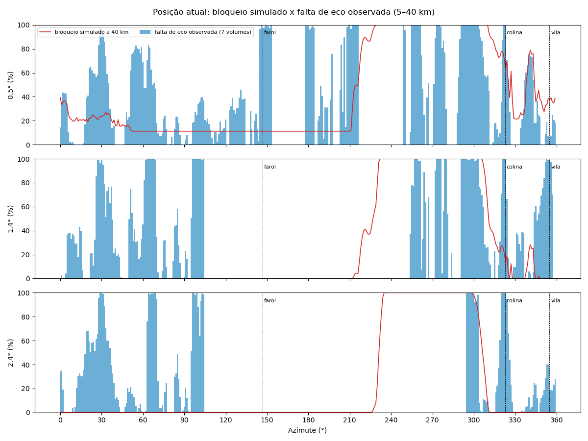
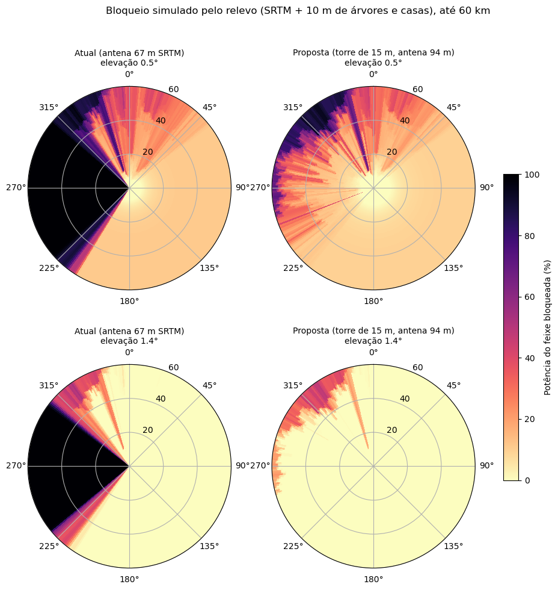
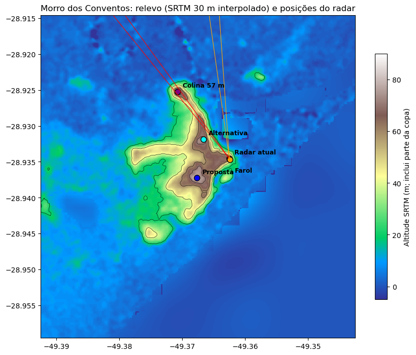

# Radar meteorológico de Araranguá: diagnóstico, bloqueios do feixe e posição alternativa

Versão 1, 19/11/2026. Relevo: SRTM 30 m. Dados: 7 volumes do FTP da Defesa Civil de SC, de 16/11 23:58 a 19/11 23:36 UTC.
A versão 2 deve usar o MDS e o MDT de 1 m do SIGSC (seção 7).

## Resumo

1. **A configuração do radar inutiliza o Doppler.** A PRF de 400/267 Hz em banda X dá velocidade de Nyquist de 6,4 m/s. A velocidade sai aleatória e o filtro de clutter, que depende dela, apaga raios inteiros de chuva.
2. **O próprio Morro dos Conventos bloqueia o oeste.** O topo do morro fica 580 m a sudoeste da antena e mais alto que ela. A simulação mostra o setor de ~225° a ~310° bloqueado nas três elevações mais baixas, e os volumes observados concordam onde é possível comparar. É a direção do interior e da Serra Geral.
3. **Há um bloqueio estreito e completo a 321–324°**, de 0,5° a 3,4° de elevação. O transmissor funciona nesse setor (o anel de vazamento continua), então o bloqueio é físico. A colina de 57 m a 1,3 km está nessa direção, mas só explica a perda total se houver mata de ~20 m no topo; um objeto perto da antena também explicaria.
4. **Posição proposta:** topo do Morro dos Conventos, **-28,93725, -49,36762**, com a antena a pelo menos 20 m da superfície do SRTM, e acima das copas e prédios num raio de 500 m. No setor oeste (240–340°), a 30 km, o bloqueio cai de 86% para 15% a 0,5° e de 74% para 0% a 1,4°. Na média de todas as direções a 60 km, cai de 46% para 32% a 0,5° e de 28% para 8% a 1,4°.

## 1. O radar

| Item | Valor (metadados ODIM) |
|---|---|
| Equipamento | EEC Ranger, software EDGE 6.2.3, banda X (λ = 3,19 cm) |
| Feixe | 2,18° (H) × 2,20° (V); ganho 36,2 dB; potência nominal 410 W |
| Varredura | 5 elevações (0,5°, 1,4°, 2,4°, 3,4°, 4,5°), 360 raios × 3840 bins de 31,25 m (120 km), a cada ~5 min |
| PRF | 400 / 267 Hz (dual-PRF 3:2), Nyquist 6,38 m/s |
| Posição real | -28,934548, -49,362490; antena a 49 m |
| Posição nos arquivos | -28,9346, -49,3627 (21 m da real); altitude declarada 46 m |

## 2. Problemas de configuração e processamento

**PRF baixa.** Com PRF de 400 Hz em banda X, mesmo uma chuva com largura espectral de 1,5–2 m/s dá SQI de 0,1–0,3. Nos ecos de chuva (RhoHV ≥ 0,95 e SNR ≥ 20 dB), a velocidade varia entre raios vizinhos tanto quanto um valor sorteado (mediana de 2,7–3,7 m/s, contra 3,7 m/s de um valor aleatório). O filtro de clutter Doppler remove 73% do eco bruto a 0,5° e 25% a 2,4–4,5°, onde quase não há clutter. A PRF de 400 Hz dá 375 km de alcance sem ambiguidade, mas o radar processa só 120 km.

**Zona cega de 2,2 km.** Até 2,17 km todos os raios, em todas as direções, ficam saturados em ~74 dBZ. É o receptor captando o pulso transmitido (14,3 µs de ida e volta). Não há medida real nesse disco.

**Clutter.** Os ecos de 30 dBZ ou mais têm RhoHV mediano de 0,54–0,71 a 0,5°, valor de mar e relevo, não de chuva.

**Recomendação ao fabricante:** PRF próxima de 1200/900 Hz (dual-PRF 4:3). Isso dá Nyquist de 9,6 e 7,2 m/s, ~29 m/s com a extensão dual-PRF, e 125 km de alcance sem ambiguidade, que cobre os 120 km processados. Com velocidade confiável, o filtro de clutter volta a funcionar.

## 3. Bloqueios observados

Fração de pontos com eco (TH ≥ 10 dBZ, 5–40 km), média dos 7 volumes:

| Setor | 0,5° | 1,4° | 2,4° | 3,4° | 4,5° | Causa provável |
|---|---|---|---|---|---|---|
| 321–324° | 2–5% (vizinhos 40–90%) | 0–1% | 0–1% | 0–2% | 6–7% (vizinhos 8–9%) | colina com mata a 1,3 km, ou objeto perto da antena |
| 352–356° | 59–78% (vizinhos 95%) | 0–0,5% (vizinhos 9–21%) | normal | normal | normal | não explicado (vila e árvores ficam abaixo do feixe) |
| a partir de 146° | 0% (antes 8–18%) | — | — | — | — | farol (15 m, topo 8 m acima da antena); depois vem o mar sem eco |
| ~225–310° | sem eco ou forte falta | 60–100% de falta em 255–310° | falta em 295–305° | — | — | topo do Morro dos Conventos (simulação) |

O farol e a vila foram medidos em campo. O farol fica a 146,8°, a 15 m, com o topo a 28° acima da antena. A vila fica a 354,9° e 1.400 m, em terreno a ~10 m com árvores de 25 m, ou seja, 0,6° abaixo da horizontal da antena; ela tira no máximo ~12% do feixe de 0,5°.

## 4. Simulação do bloqueio

Método: bloqueio parcial do feixe (Bech et al., 2003), com Terra de raio efetivo 4/3, feixe de 2,2° e bloqueio acumulado ao longo do raio. O relevo é o SRTM de 30 m: interpolado a ~8 m até 4 km do radar e a ~67 m até 100 km. Picos isolados do SRTM foram removidos. Árvores e casas entram como altura somada ao terreno em terra firme (+10 m no cenário base, +20 m no pessimista). Os primeiros 100 m não entram, porque ali o SRTM não representa o entorno e o feixe ainda está em campo próximo.

**Referência de altitude.** O SRTM dá 72 m na colina e 64 m no radar, contra 57 m e 49 m no Google Earth. A diferença é a mesma nos dois pontos (~15 m), típica do SRTM sobre mata. Por isso a antena foi posta a 64–67 m no referencial do SRTM; 67 m com +10 m de obstáculos foi o melhor ajuste aos volumes observados.

**Validação.** A correlação entre o bloqueio simulado e a falta de eco observada é modesta (0,25–0,33). Os 7 volumes têm chuva em lugares diferentes, e o SRTM não mostra postes, mastros nem árvores isoladas. A simulação reproduz o bloqueio do setor oeste. O setor 321–324° só aparece com mata de ~20 m no topo da colina, e o setor 352–356° não aparece.

## 5. Posição alternativa

Foram avaliados 198 pontos do Morro dos Conventos (grade de 100 m, terreno acima de 20 m) e 226 topos de morro num raio de 15 km (grade de 500 m), com torres de 10, 20 e 30 m. A melhor posição é o **topo do Morro dos Conventos, -28,93725, -49,36762**, 580 m a 239° da antena atual. Na região de 15 km, nenhum ponto foi melhor.

Potência média bloqueada a 60 km, média de todos os azimutes:

| Posição | Torre | Árvores | 0,5° | 1,4° | 2,4° | Azimutes limpos a 0,5° |
|---|---|---|---|---|---|---|
| Atual | — | +10 m | 46% | 28% | 21% | 0% |
| Atual | — | +20 m | 48% | 33% | 29% | 0% |
| Proposta | 10 m | +10 m | 32% | 8% | 0% | 46% |
| Proposta | 10 m | +20 m | 70% | 49% | 23% | 16% |
| **Proposta** | **20 m** | **+10 m** | **32%** | **8%** | **0%** | **47%** |
| **Proposta** | **20 m** | **+20 m** | **32%** | **8%** | **0%** | **46%** |
| Proposta | 30 m | +20 m | 32% | 8% | 0% | 47% |

A torre de 10 m só funciona se a mata em volta for baixa. **Com 20 m, o resultado não depende das árvores.** Acima de 20 m não há ganho, porque o limite passa a ser o relevo distante.

Os 32% restantes a 0,5° (torre de 20 m) se dividem assim:

| Setor | Bloqueio a 0,5° | Origem |
|---|---|---|
| Mar, 60–200° | 9% | a parte de baixo do feixe de 2,2° aponta abaixo do horizonte e toca a superfície; acontece até sobre mar plano |
| Norte, 340–60° | 32% | morros em direção a Criciúma |
| Oeste e noroeste, 240–340° | 71% | relevo distante, até a escarpa da Serra Geral |

A oeste e noroeste está o maior ganho da mudança, porque hoje o topo do próprio morro tapa esse setor:

| Setor 240–340° | 0,5° | 1,4° | 2,4° |
|---|---|---|---|
| Atual, a 30 km | 86% | 74% | 66% |
| Proposta (torre de 20 m), a 30 km | 15% | 0% | 0% |
| Atual, a 60 km | 97% | 82% | 66% |
| Proposta (torre de 20 m), a 60 km | 71% | 25% | 0% |

Além de ~40 km a oeste, o relevo distante continua bloqueando a 0,5° em qualquer posição perto da costa. Nesse setor, o produto de chuva deve usar 1,4° ou 2,4°.

A altura vale no referencial do SRTM. Na prática, o critério é ter a antena **pelo menos 5 m acima das copas e dos prédios num raio de 500 m**.

## 6. Limitações

- O SRTM tem 30 m de resolução, é de 2000 e mistura terreno com parte da copa. Ele não representa postes, mastros, antenas, prédios isolados nem árvores isoladas.
- A altura das árvores e casas é uniforme na simulação. A versão 2 deve usar o MDS do SIGSC, que mede a superfície real a 1 m.
- A validação usa 7 volumes. Com mais horários de chuva bem distribuída, a comparação fica mais firme.
- A posição proposta precisa de visita: acesso, posse da área, energia, comunicação e a vegetação real em volta.

## 7. Próximos passos: MDS e MDT do SIGSC

O levantamento aerofotogramétrico de SC (2010–2012) tem MDS (superfície, com prédios e árvores) e MDT (terreno) com 1 m de resolução, recortados em folhas 1:50.000.

| Prioridade | Folha 1:50.000 | Área | Cobre |
|---|---|---|---|
| Essencial | **SH-22-X-B-IV-3** | lat -29,00 a -28,75; lon -49,50 a -49,25 | radar, posição proposta, colina, centro de Araranguá |
| Alta | SH-22-X-A-VI-4 | lat -29,00 a -28,75; lon -49,75 a -49,50 | oeste de Araranguá, setor bloqueado a oeste |
| Média | SH-22-X-B-IV-1 | lat -28,75 a -28,50; lon -49,50 a -49,25 | norte, em direção a Criciúma |
| Baixa | SH-22-X-B-IV-4, SH-22-X-D-I-1, SH-22-X-D-I-2, SH-22-X-C-III-2 | leste e sul | costa e mar |

Com o MDS e o MDT, a diferença entre os dois dá a altura real de prédios e árvores. Isso substitui a hipótese de +10 ou +20 m e permite testar o setor 321–324° e o 352–356°.

## 8. Como reproduzir

Scripts em `radar-sc/`:

| Script | Função |
|---|---|
| `baixar_ftp_sc.py --amostra ARA --quantas N` | baixa volumes de amostra do FTP |
| `diagnostico_odim.py` | qualidade por elevação (filtro, RhoHV, velocidade, SQI) |
| `comparar_azimutes.py` | falhas fixas x falhas que mudam entre horários |
| `relevo.py`, `simular_bloqueio.py` | relevo e simulação do bloqueio |
| `buscar_posicao.py` | busca de posições |
| `figuras_relatorio_ararangua.py` | figuras e `relatorio/sensibilidade.csv` |
| `gerar_kml_bloqueio.py` | KML para conferência no Google Earth |

Referência: Bech, J., Codina, B., Lorente, J., Bebbington, D. (2003). The sensitivity of single polarization weather radar beam blockage correction to variability in the vertical refractivity gradient. *J. Atmos. Oceanic Technol.*, 20, 845–855.
